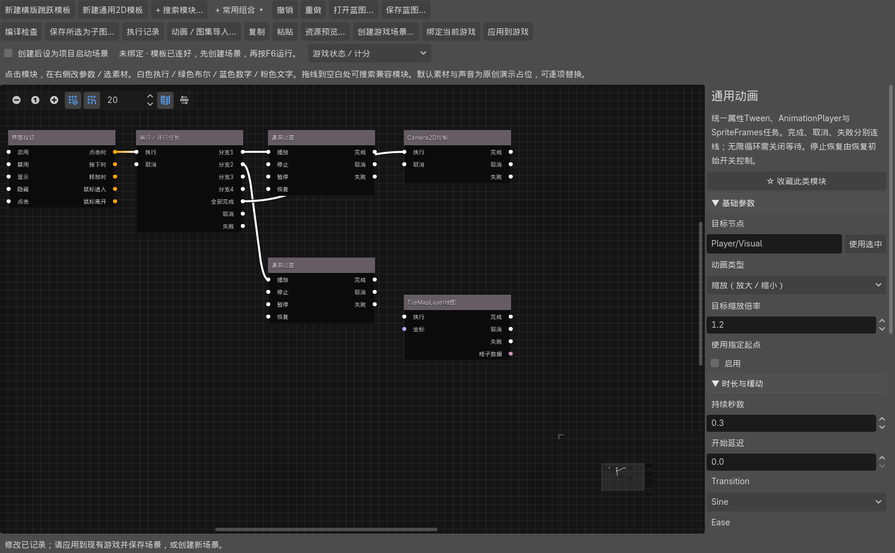
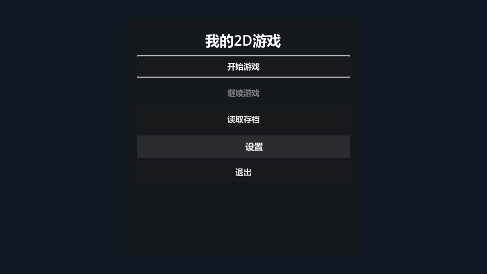
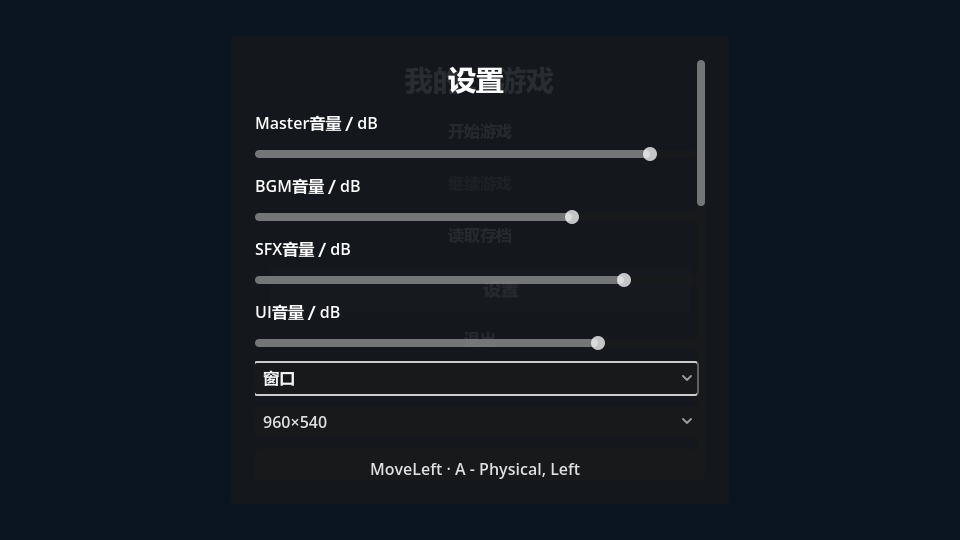

# AlI Blueprint 0.5：2D使用步骤与验收

2026年11月18日 · 插件0.5.0 · Godot4.6 · API6。

按用户最新说明统一完成全部适用2D范围，阶段仅用于组织实施；Camera3D、2.5D、Sprite3D／Billboard和3D预览暂缓。71类游戏模块、13类角色模块，详细字段见[模块手册](GODOT_BLUEPRINT_CATALOG.md)，执行、存档和兼容语义见[技术文档](GODOT_BLUEPRINT_TECHNICAL.md)。

## 从空白项目开始

1. 将安装包中的addons/ali_assets放进Godot4.6项目，在项目设置→插件启用AlI。
2. 右侧AlI素材→创建2D游戏框架，选空白2D、基础2D、平台跳跃或跑酷。
3. 输入新目录如res://games/my_game。默认不改启动场景，需要F5从主菜单启动时勾选相应选项。已有目录会拒绝，不覆盖项目。
4. 打开MainMenu.tscn按F6。开始、继续、设置、存档和退出均可操作；继续按钮在没有有效存档时禁用。
5. Game.tscn包含实际世界。基础2D用WASD／方向键移动，Shift奔跑；平台模板Space跳跃；J或鼠标左键发攻击信号，E交互，Esc暂停，F5／F9快速存取。跑酷模板Space实际跳跃。
6. PauseMenu、SettingsMenu、SaveLoadMenu、GameOver是普通Godot控件，可修改文字、图片、布局和绑定。Game引用暂停／结束场景文件，不是独立脱节副本。
7. 菜单根节点framework字典保存场景路径和框架key，bindings映射按钮名到动作，effects设置悬停、按下、淡入、滑入等反馈，可关闭。

用户原AlITestGodot保持空白；示例／验收位于独立目录。模板图形、声音为原创代码占位，不能视为AI美术效果证明。

## 修改游戏逻辑

1. 打开Game，选择游戏根节点，在AlI素材→游戏蓝图工作台点击绑定当前游戏。
2. 右键搜索名称／类别，或拖执行线到空白搜索兼容模块。星标收藏常用类型；支持多选、复制粘贴、Delete、撤销重做。
3. 点模块，右侧折叠参数；拖入图片、声音、SpriteFrames、Animation／Library、TileSet或场景。节点路径栏可从场景树拖入，也可使用选中节点。
4. JSON字段编辑后点应用JSON。类型化参数的向量写数组；错误类型／失效路径编译时会提示。
5. 点编译检查，再应用到游戏，最后保存Godot场景。保存蓝图JSON只保存草稿，不自动改变场景。
6. 旧API场景只能读取原图；创建新名称场景升级，原场景与运行副本保留。

## 一个UI动效流程

在Godot场景中创建Button、Label、ProgressBar等普通控件。通过button模块绑定Button，选择四状态贴图和声音；开启effects_enabled可配置悬停1.1、按下0.95和点击Animation。Container布局也支持反馈。

需要多步骤：Button点击→task_group（serial），分支1→animation（位置／缩放），分支2→animation（RGBA），组“全部完成”→scene_service。并行动画把组改parallel。每个分支等待整个下游完成；旧Sequence仍不等待。

ui_control可显示隐藏、改文字、图片、颜色、数值与交互状态；property_get读属性，ui_event监听pressed／value_changed／text_changed等原生信号。数据类型要匹配。可将失败出口连接log或提示模块。

## 动画与Camera2D

1. 通用动画选择目标Control、Node2D、AnimatedSprite2D或AnimationPlayer，按需选类型、片段和参数。
2. 拖SpriteFrames时，在已绑定游戏中只有一个适用AnimatedSprite2D会自动选择；多个候选须明确选择，避免猜错。
3. Animation轨道报路径错误时，在remap写映射，如{"OldVisual":"Player/Visual"}，或对适用轨道启用retarget。
4. 独立预览可播放／暂停／复位，原场景、脚本和源文件不改变。无限循环关闭“等待结束”，并安排停止端口。
5. Camera2D选择相机目标，配置跟随、缩放、震动、移动、切换、偏移和边界。平台／俯视／即时跟随预设可继续修改；有限过渡可接串并行。

## 导入图片序列与瓦片图集

游戏工作台→动画／图集导入。序列选择多图，默认自然文件名顺序，可上下移帧或反序，设置片段名、帧率和循环；默认输出SpriteFrames。Sprite Sheet设置格宽高或按行列反算，边距、间距，预览并选择需要的帧。

只有显式勾选才输出Animation资源，目标填写Sprite2D相对路径，生成texture属性轨道。不是自动把PNG当成完整动画。

瓦片模式选择一张图集，设置格尺寸、边距、间距并选择瓦片，保存新TileSet。然后在Godot原生TileSet编辑器配置复杂地形与碰撞；导入器不自动猜测这些含义。

## 地图、背景和场景物体

1. 原生编辑器创建Ground、Walls、Decoration等TileMapLayer，分配TileSet，完成地图绘制。
2. 蓝图tilemap拖入图层或留空自动创建；为各层使用唯一save_key。选择瓦片按钮可浏览Atlas源与替代ID；原生编辑器按钮定位图层或TileSet。
3. 根据事件执行set／erase／fill／clear_region／read／terrain等。地形连接要求原TileSet已配置。世界↔格子转换处理变换后的图层。
4. 大范围操作分帧，完成出口后再继续；取消保留已修改部分。存档只保存差量，恢复时先载入基础地图。
5. background使用Sprite2D或Parallax2D，多层、平铺、自动滚动、透明度和切换可配置；动画复用通用动画。
6. scene_object拖图片、SpriteFrames或PackedScene，创建后从对象输出接数据，或按场景路径操作；可显示隐藏、变换、动画、碰撞。ui_event／signal_event可接实际物体信号。

## 变量、事件与可复用子图

黑板可选本游戏／子图局部或project全局。类型和写入作用域必须与声明一致，全局默认跨场景保留。event_send／receive带类型参数，可以在角色与游戏图之间通信；project作用域按同一框架key隔离。

选中逻辑模块保存子图，需恰好一个外部执行入口／出口；跨边界数据节点一并选入。加入module_input和module_output后保存为参数化子图，调用时填参数字典，完成后从返回字典读取字段。局部变量不泄漏，递归和无限等待会拒绝；源JSON改动后重新应用场景。

## 设置与保存

设置菜单可改四路音量、窗口模式、分辨率和键位；改键时下一次键盘／鼠标输入替换绑定，Esc取消，默认拒绝冲突。蓝图input_bind支持追加、多键、共享或抢占冲突。设置保存独立于游戏槽。

默认存档菜单有3槽，蓝图可访问0–20槽，0快速。保存变量、场景、角色指定状态、生命与FSM、注册数据及地图差量；读取先恢复场景和对象，再验证数据。复杂动态对象请自行在loaded事件依据注册数据重建。user://文件带版本和校验，损坏槽保留，可删除或恢复备份。

## 验收范围与实施顺序

| 顺序 | 实现与原生验收 |
| --- | --- |
| 编辑器基础 | 资源拖放／UID／重导入／预览／折叠；搜索收藏、多选移动、模块组复制、Undo、类型拒绝与定位 |
| 动画与执行 | 属性Tween、原生Animation／Library／Player、SpriteFrames；等待串并行与嵌套、取消、暂停、UI继续、恢复、目标删除、超时和无限等待保护 |
| UI与世界 | 十二种原生Control、四状态按钮／声音／动效、快速重复触发与Container恢复；背景／物体、TileSet导入与地图批处理／地形／碰撞／差量 |
| 2D相机 | 移动、跟随、缩放、旋转、震动、切换、偏移、边界、预设、串并行与隔离预览 |
| 服务与模板 | InputMap、场景预加载转场、生命周期、四路音频／位置／渐变、独立设置、存档；四模板与六场景实际菜单、跳跃、暂停、保存载入 |
| 通用能力 | 扩展类型安全编码、事件作用域与角色往返、局部／全局变量、参数化子图冻结／返回／隔离／递归保护 |
| 兼容与文档 | 原角色、程序图、跑酷、资源与按钮回归；自含运行模块；旧文件保护、文档和离线包 |

重现入口：tools.verify_blueprint2d（全部新功能）、tools.verify_godot_graph（角色）、tools.verify_godot_game（原跑酷）、tools.verify_godot_program（原程序图）、tools.verify_blueprint05（资源／按钮）。均使用新的隔离证明目录，不写用户场景。静态与原生资源检查使用Godot skill的validate_project。

这些验收证明机制与接线行为。未将跨窗口真实鼠标拖放手势自动录制当作已测；原生拖放协议和资源赋值有验证。没有新AI素材质量或多平台发行包验收。完整背包、网络、行为树、复杂战斗等不在本次原0.5适用范围。
