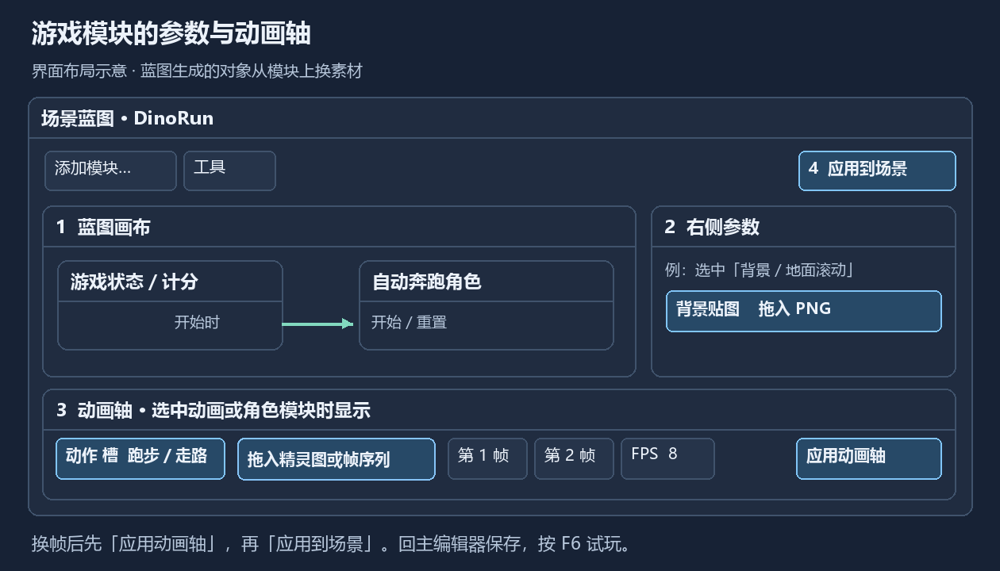

# 小恐龙跑酷制作教程

按本页顺序操作即可从空白场景做到可试玩。已搭好的 `test-game` 可以直接按 F5 试玩，含菜单美术、关卡背景、三段角色动画、两首音乐和三项音效。从头练习时，用自己的空白项目执行以下步骤。前七节用基本形状作临时素材，第八节再换成自己生成的精灵图、图片和声音。教程使用 Godot 4.6 和新版 AlI 插件。

## 1. 准备六个场景和认清端口

1. 空白项目先安装 AlI。在 AlI 选「Godot → 连接项目／安装插件」，选择含 `project.godot` 的目录。在 Godot 的「项目 → 项目设置 → 插件」启用「AlI游戏素材」。需要复查已搭好的 `test-game` 时，用蓝图窗口顶部的场景菜单切换到相应场景。
2. 在 Godot 右侧的「AlI 素材」点「新建基础场景…」，把下表文件保存在项目根目录。若 `Main.tscn` 或 `DinoRun.tscn` 已存在，直接打开对应文件。每个文件单独保存自己的蓝图。
3. 在「项目 → 项目设置 → 应用 → 运行」把主场景设为 `res://Main.tscn`。项目设置中的视口建议为 960×540，拉伸模式选 `canvas_items`。

| 场景文件 | 用途 | 从哪里进入 |
| --- | --- | --- |
| `Main.tscn` | 主界面 | F5 启动，或从暂停／结束返回 |
| `DinoRun.tscn` | 本局跑酷 | 主界面「开始游戏」或读取存档 |
| `PauseMenu.tscn` | 暂停界面 | 游戏中按 Esc，暂停原局并叠加 |
| `SaveMenu.tscn` | 存档与读取 | 暂停界面的「存档与读取」 |
| `SettingsMenu.tscn` | 音量设置 | 主界面或暂停界面的「设置」 |
| `GameOver.tscn` | 结束界面 | 碰撞后叠加 |

从蓝图窗口顶部场景菜单切换，每一节先确认顶部显示的是该节的场景。每做完一个场景，先点「应用到场景」，然后回 Godot 按 Ctrl+S。F5 从主界面加载全游戏；F6 适合单独调试跑酷。暂停、存档、设置和结束界面通过各自的入口试玩。



### 模块怎么添加和连线

1. 点「添加模块」，按「模块类型」搜索，双击结果添加。选中模块后，在右侧「模块名称」输入表格里的名称并按 Enter。随后按参数列填写。名称相同的原生节点与蓝图模块分别在场景树和蓝图画布操作。
2. 模块**左侧是输入，右侧是输出**。`▶` 是执行端口，决定何时运行；`◇` 是数据端口，提供数值、文本或引用。白色或橙色端口用于执行，彩色数据端口按类型连接。表格每一行是一条线，拖动时从左列模块的**右侧端口**拖到右列模块的**左侧端口**。

```
┌── 开始按钮事件 ──┐                  ┌── 进入游戏 ─────────────────┐
│           输出  │                  │ 输入                        │
│         触发 ▶ ●├────────────────▶┤● ▶ 执行                     │
└─────────────────┘                  └────────────────────────────┘

数据示例    读取分数 右「值 ◇」 →  格式化分数 左「◇ 值」
```

3. 在 Godot 主窗口的**场景树**选根节点，添加本页指定类型的子节点，按表重命名。选 Label 或 Button 后，在检查器填 Text，展开 Layout → Transform 填 Position 和 Size。每个节点都直接挂在该场景根节点下，`AlIBlueprint` 节点由插件处理。
4. 按钮的「UI事件」将「目标节点」绑定为对应的 Button，「原生信号」用 `pressed`，「游戏暂停时触发」保持勾选。设置滑条使用第六节注明的 `value_changed`。下面每个场景都单独列出要连的线。

## 2. 在 Main.tscn 搭主界面

创建 `Title`（Label，文字「小恐龙跑酷」，位置 32,24）。添加三个 Button，宽高 220×40，X 均为 32。

| 场景节点名 | Text | Y |
| --- | --- | --- |
| `Start` | 开始游戏 | 90 |
| `Load` | 读取存档 | 141 |
| `Settings` | 设置 | 192 |

| 模块名称 | 模块类型 | 参数 |
| --- | --- | --- |
| 开始按钮事件 | UI事件 | 目标 `Start` |
| 读档按钮事件 | UI事件 | 目标 `Load` |
| 设置按钮事件 | UI事件 | 目标 `Settings` |
| 进入游戏 | 场景切换／转场 | 场景操作「切换」，目标 `DinoRun.tscn` |
| 读取槽位 | 存档管理 | 存档操作「读取」，槽位 `1` |
| 打开设置 | 场景切换／转场 | 场景操作「打开叠加界面」，目标 `SettingsMenu.tscn`，关闭「界面打开时暂停游戏」，试听时主菜单音乐继续播放 |

| 输出模块 · 右侧端口 | 输入模块 · 左侧端口 |
| --- | --- |
| 开始按钮事件 · 触发 | 进入游戏 · 执行 |
| 读档按钮事件 · 触发 | 读取槽位 · 执行 |
| 设置按钮事件 · 触发 | 打开设置 · 执行 |

应用并保存 `Main.tscn`。F5 可以先看到三个按钮，等设置和游戏蓝图做好后再测试它们。槽位 1 在第 5 节第一次写入。

## 3. 在 DinoRun.tscn 用基础节点搭跑酷

先建立三件原生物体。下表位置都相对于 `DinoRun` 根节点。每个物体下添加 `CollisionShape2D`，在 Shape 新建 `RectangleShape2D` 并填尺寸。再加一个 `ColorRect` 作临时外观。把 ColorRect 的 Position 设成碰撞尺寸的一半取负，Size 与碰撞尺寸一致，Mouse → Filter 设为 Ignore。角色用绿色、地面用深灰、障碍用橙色即可。

| 场景节点 | 类型 | Position | 碰撞尺寸和图层 |
| --- | --- | --- | --- |
| `Player` | CharacterBody2D | 100,414 | 32×40，Layer 1、Mask 2 |
| `Floor` | StaticBody2D | 480,454 | 960×40，Layer 2、Mask 全关 |
| `Obstacle` | Area2D | 980,410 | 30×48，Mask 1，勾选 Monitoring |
| `Score` | Label | 20,16 | 文字「分数 0」，大小 220×40 |

添加「画面比例」，设 960×540、保持比例／黑边。以下几组模块都在 **`DinoRun.tscn` 的蓝图**操作。在属性类模块里先绑定目标节点，再从「支持的属性」选择 `velocity:y` 或 `position:x`。这两个属性分别是纵向速度和横向位置。

### 3.1 重力与移动

| 模块名称 | 模块类型 | 参数 |
| --- | --- | --- |
| 物理帧 | 帧更新事件 | 更新时机「物理帧」 |
| 读取纵速 | 读取属性 | `Player`，`velocity:y`，类型「数字」 |
| 本帧重力 | 数字运算 | 「乘」，未接线时 A=1600 |
| 新纵速 | 数字运算 | 「加」 |
| 写入纵速 | 修改属性 | `Player`，`velocity:y`，类型「数字」 |
| 移动角色 | 受支持方法 | `Player`，`move_and_slide（角色移动并滑动）`，参数 `[]` |

| 右侧输出 | 左侧输入 |
| --- | --- |
| 物理帧 · 帧间隔 ◇ | 本帧重力 · B ◇ |
| 读取纵速 · 值 ◇ | 新纵速 · A ◇ |
| 本帧重力 · 结果 ◇ | 新纵速 · B ◇ |
| 新纵速 · 结果 ◇ | 写入纵速 · 值 ◇ |
| 物理帧 · 更新 | 写入纵速 · 执行 |
| 写入纵速 · 完成 | 移动角色 · 执行 |

公式是「新纵速 = 原纵速 + 重力 × 帧间隔」。角色接触地面时，Godot 的碰撞系统负责阻止下落。

### 3.2 只在落地时允许跳跃

| 模块名称 | 模块类型 | 参数 |
| --- | --- | --- |
| 空格 | 自定义按键事件 | Space |
| 检查落地 | 2D接触状态 | `Player`，接触方向「地面」 |
| 能否跳跃 | 条件分支 | 布尔条件通过连线输入 |
| 写入起跳速度 | 修改属性 | `Player`，`velocity:y`，类型「数字」，默认值 JSON `-620` |

| 右侧输出 | 左侧输入 |
| --- | --- |
| 空格 · 按下 | 能否跳跃 · 判断 |
| 检查落地 · 是否接触 ◇ | 能否跳跃 · 布尔条件 ◇ |
| 能否跳跃 · 成立 | 写入起跳速度 · 执行 |

应用后按 F6 先验证这一组。Space 应起跳，腾空时再次按 Space 不会增加一次跳跃。

### 3.3 移动障碍和检测碰撞

沿用 3.1 的「物理帧」。每帧把障碍向左移动 `300 × 帧间隔` 个像素，越过左边缘后回到右侧。

| 模块名称 | 模块类型 | 参数 |
| --- | --- | --- |
| 读取障碍X | 读取属性 | `Obstacle`，`position:x`，类型「数字」 |
| 本帧距离 | 数字运算 | 「乘」，未接线时 A=300 |
| 新障碍X | 数字运算 | 「减」 |
| 移动障碍 | 修改属性 | `Obstacle`，`position:x`，类型「数字」 |
| 比较边缘 | 数字比较 | 「小于等于」，未接线时 B=-30 |
| 是否出界 | 条件分支 | 布尔条件通过连线输入 |
| 障碍回到右侧 | 修改属性 | `Obstacle`，`position:x`，类型「数字」，默认值 JSON `980` |
| 碰撞 | 场景信号事件 | 目标路径 `Obstacle`，信号名 `body_entered` |
| 打开结束 | 场景切换／转场 | 「打开叠加界面」，目标 `GameOver.tscn`，勾选「界面打开时暂停游戏」 |

| 右侧输出 | 左侧输入 |
| --- | --- |
| 物理帧 · 帧间隔 ◇ | 本帧距离 · B ◇ |
| 读取障碍X · 值 ◇ | 新障碍X · A ◇ |
| 本帧距离 · 结果 ◇ | 新障碍X · B ◇ |
| 新障碍X · 结果 ◇ | 移动障碍 · 值 ◇ |
| 物理帧 · 更新 | 移动障碍 · 执行 |
| 读取障碍X · 值 ◇ | 比较边缘 · A ◇ |
| 比较边缘 · 结果 ◇ | 是否出界 · 布尔条件 ◇ |
| 移动障碍 · 完成 | 是否出界 · 判断 |
| 是否出界 · 成立 | 障碍回到右侧 · 执行 |
| 碰撞 · 触发 | 打开结束 · 执行 |

### 3.4 计时、计分和暂停

| 模块名称 | 模块类型 | 参数 |
| --- | --- | --- |
| 初始化 | 游戏／场景事件 | 「初始化完成」 |
| 读档完成 | 游戏／场景事件 | 「存档恢复完成」 |
| 秒表 | 计时器 | 间隔 1 秒，勾选重复 |
| 读取分数 | 黑板变量 | 变量名 `score`，变量范围「本游戏实例」，类型「数字」，初始数字 0 |
| 分数加一 | 数字运算 | 「加」，未接线时 B=1 |
| 保存分数变量 | 写入变量 | 变量名 `score`，变量范围「本游戏实例」，类型「数字」 |
| 格式化分数 | 文字格式化 | 输入类型「数字」，文字 `分数 {value}` |
| 更新分数界面 | 通用UI操作 | 目标 `Score`，UI操作「文字」，数据类型「文字」 |
| 暂停键 | 自定义按键事件 | Esc |
| 打开暂停 | 场景切换／转场 | 「打开叠加界面」，目标 `PauseMenu.tscn`，勾选「界面打开时暂停游戏」 |

| 右侧输出 | 左侧输入 |
| --- | --- |
| 初始化 · 发生 | 秒表 · 启动 |
| 秒表 · 到时 | 保存分数变量 · 写入 |
| 读取分数 · 当前值 ◇ | 分数加一 · A ◇ |
| 分数加一 · 结果 ◇ | 保存分数变量 · 值 ◇ |
| 保存分数变量 · 完成 | 更新分数界面 · 执行 |
| 读档完成 · 发生 | 更新分数界面 · 执行 |
| 读取分数 · 当前值 ◇ | 格式化分数 · 值 ◇ |
| 格式化分数 · 文字 ◇ | 更新分数界面 · 值 ◇ |
| 暂停键 · 按下 | 打开暂停 · 执行 |

应用并保存 `DinoRun.tscn`。关卡现在可以移动、跳跃、计时计分和碰撞。继续为接下来的四个场景添加交互。


## 4. 在 PauseMenu.tscn 搭暂停界面

添加 `Title`（Label，文字「已暂停」，位置 32,24）。在根节点下添加四个 Button，X 都是 32，宽高 220×40。按下表从 Y=90 开始每次加 51。先给每个按钮建一份 `UI事件`，再分别添加和配置右列的动作模块。

| Button 名／Text | UI事件模块 · 右「触发」 | 动作模块 · 左「执行」和参数 |
| --- | --- | --- |
| `Resume`／继续游戏 | 继续按钮事件 | 关闭暂停（场景切换／转场，「关闭当前叠加界面」） |
| `Save`／存档与读取 | 存档按钮事件 | 打开存档（场景切换／转场，「打开叠加界面」，目标 `SaveMenu.tscn`） |
| `Settings`／设置 | 设置按钮事件 | 打开设置（场景切换／转场，「打开叠加界面」，目标 `SettingsMenu.tscn`） |
| `Menu`／返回主界面 | 返回按钮事件 | 回主界面（场景切换／转场，「切换」，目标 `Main.tscn`） |

打开存档和打开设置的「界面打开时暂停游戏」保持关闭。原局已由 `DinoRun.tscn` 打开的暂停界面暂停。返回上一级时仍停在暂停界面；点「继续游戏」才恢复原局。应用并保存 `PauseMenu.tscn`。

## 5. 在 SaveMenu.tscn 搭存档界面

添加 `Title`（Label，文字「存档与读取」，位置 32,24）。添加 `Write`、`Load` 和 `Back` 三个 Button，Text 依次为「保存到槽位 1」「读取槽位 1」「返回暂停」。X 均为 32，Y 分别为 90、141、192，大小 220×40。另加 `Note`（Label，文字「存档已写入」，位置 32,264），在检查器的 Visibility 取消 Visible。

| 模块名称 | 模块类型 | 参数 |
| --- | --- | --- |
| 保存按钮事件 | UI事件 | 目标 `Write` |
| 读取按钮事件 | UI事件 | 目标 `Load` |
| 返回按钮事件 | UI事件 | 目标 `Back` |
| 写入槽位 | 存档管理 | 存档操作「创建／覆盖」，槽位 `1` |
| 读取槽位 | 存档管理 | 存档操作「读取」，槽位 `1` |
| 显示存档提示 | 通用UI操作 | 目标 `Note`，UI操作「显示」 |
| 隐藏存档提示 | 通用UI操作 | 目标 `Note`，UI操作「隐藏」 |
| 关闭存档 | 场景切换／转场 | 「关闭当前叠加界面」 |

| 输出模块 · 右侧端口 | 输入模块 · 左侧端口 |
| --- | --- |
| 保存按钮事件 · 触发 | 写入槽位 · 执行 |
| 写入槽位 · 完成 | 显示存档提示 · 执行 |
| 读取按钮事件 · 触发 | 读取槽位 · 执行 |
| 返回按钮事件 · 触发 | 隐藏存档提示 · 执行 |
| 隐藏存档提示 · 完成 | 关闭存档 · 执行 |

应用并保存 `SaveMenu.tscn`。本例存档保存跑酷场景、分数和用时。读取后载入该场景、恢复分数与用时，障碍重新生成。可以从主界面直接读取同一个槽位。

## 6. 在 SettingsMenu.tscn 搭设置界面

添加 `Title`（Label，文字「声音设置」）、`Reset`（「恢复默认音量」）、`Back`（「返回」）和四个 HSlider。滑条范围 **-60 到 0 dB**，步长 1，最左端为静音。滑条 X=150，宽 285，四行由 Y=128 开始每行加 55。按钮 X=32，从 Y=360 开始每行加 51。每个滑条左侧放对应名称。

| 控件名 | 标签 | 设置通道 | 默认 dB |
| --- | --- | --- | --- |
| `MasterVolume` | 总音量 | Master | 0 |
| `BGMVolume` | 背景音乐 | BGM | -12 |
| `SFXVolume` | 游戏音效 | SFX | -4 |
| `UIVolume` | 界面音效 | UI | -8 |

**拖动时写入并保存。** 每行放一个「UI事件」，目标为对应 HSlider，原生信号填 `value_changed`，参数类型为数字，允许暂停时触发。每行再放一个「设置管理」，操作选「音量」，通道按表填写。

| 输出模块 · 右侧端口 | 输入模块 · 左侧端口 |
| --- | --- |
| 对应滑条的 UI事件 · 触发 ▶ | 对应音量设置 · 执行 ▶ |
| 对应滑条的 UI事件 · 参数 ◇ | 对应音量设置 · 值 ◇ |

**打开设置时回填。** 放一个「游戏／场景事件」，事件选「初始化完成」。放一个「设置管理」，操作选「读取当前设置」。放一个「数组／字典操作」，集合类型 Dictionary、按键读取、键 `volumes`、输出类型为字典。每路各放一个同类模块读取对应通道键（数字），再放一个「通用UI操作」，目标设为该 HSlider，UI操作选「设置数值（无通知）」，数据类型设为数字。

| 输出模块 · 右侧端口 | 输入模块 · 左侧端口 |
| --- | --- |
| 设置初始化 · 发生 ▶ | 读取当前设置 · 执行 ▶ |
| 读取当前设置 · 当前值 ◇ | 读取四路音量 · 集合 ◇ |
| 读取四路音量 · 结果 ◇ | 读取单路音量 · 集合 ◇（四路各接一次） |
| 读取单路音量 · 结果 ◇ | 同步对应滑条 · 值 ◇ |
| 读取当前设置 · 完成 ▶ | 同步对应滑条 · 执行 ▶（四路各接一次） |
| 恢复默认音量按钮 · 触发 ▶ | 设置管理「恢复默认音量」 · 执行 ▶ |
| 恢复默认音量 · 完成 ▶ | 读取当前设置 · 执行 ▶ |
| 返回按钮 · 触发 ▶ | 场景切换／转场「关闭当前叠加界面」 · 执行 ▶ |

应用并保存 `SettingsMenu.tscn`。主界面和暂停界面共用这张蓝图。每次调整立即保存，回填不会再次触发写入，恢复默认只重置这四路音量。返回暂停时关卡音乐仍暂停，点继续后接着播放。

## 7. 在 GameOver.tscn 搭结束界面并试玩全流程

添加 `Title`（Label，文字「游戏结束」，位置 32,24）。添加 `Retry` 和 `Menu` 两个 Button，Text 为「再来一局」「返回主界面」，大小 220×40，X=32，Y 分别为 90、141。

| UI事件模块 · 右「触发」 | 绑定按钮 | 动作模块 · 左「执行」和参数 |
| --- | --- | --- |
| 再来按钮事件 | `Retry` | 重开跑酷（场景切换／转场，「重载」） |
| 返回按钮事件 | `Menu` | 回主界面（场景切换／转场，「切换」，目标 `Main.tscn`） |

应用并保存 `GameOver.tscn`。「重载」重开背后的 `DinoRun.tscn`。按 F5，依次完成下面的测试，再替换美术素材。

1. 在主界面点「设置」，降低音量并返回。点「开始游戏」，确认滚动、计分和 Space 跳跃。
2. 按 Esc，确认角色、障碍和分数停止。点「存档与读取」，保存到槽位 1，看到「存档已写入」。点「返回暂停」，确认原局继续保持暂停；再点「继续游戏」。
3. 再次暂停并返回主界面，点「读取存档」。应进入 `DinoRun.tscn` 并接着存档的分数和用时。
4. 让角色碰到障碍。点「再来一局」，确认新局分数从 0 开始。再次碰撞并测试「返回主界面」。

## 8. 用 AlI 生成并替换素材

先建好并验证上面的游戏，再替换每个资产。项目的 `art/dino`、`art/world`、`art/ui` 和 `audio` 文件夹由插件准备。可把生成完的图片和声音另存进去，等 Godot 文件系统显示它们。精灵图可从项目外直接拖入动画轴。

### 在 DinoRun.tscn 换恐龙动画

1. 在 AlI 选「单张」，输入 `原创小恐龙，浅绿色，右侧视角，像素游戏角色，全身可见，尾巴和双脚完整，透明主体，固定大小，无文字。` 生成并另存 `art/dino/base.png`。
2. 切到「动画帧」，拖入 `base.png` 当参考图。每个动作先固定为 2 秒，分别生成。保持右侧视角、颜色、比例和脚底基准。

| 动作 | 追加到用户需求的内容 |
| --- | --- |
| 跑步 | 原地奔跑循环，两脚交替蹬地，尾巴轻微摆动，主体留在中央，游戏引擎将处理移动 |
| 跳跃 | 从站姿垂直起跳，躯干保持直立，收腿后原地落地，保持脚底基准，避免前扑或横向位移 |
| 死亡 | 向后倒地，背部着地后短暂停顿，然后逐渐消散，固定镜头，单次播放 |

3. 预览后点「选帧与导出」，本例点「全选」，保留「透明背景」，播放 FPS 设为 24。2 秒动作共有 48 帧；跑步勾选循环，跳跃和死亡关闭循环。可以保存单帧编号 PNG 序列，或保存一张精灵图 PNG 与同名 JSON。
4. 回到 `DinoRun.tscn`，在 `Player` 下加 `AnimatedSprite2D`，命名 `Visual`。先把 `Player` 原有的占位 `ColorRect` 隐藏。添加三个「通用动画」模块，目标节点都选 `Player/Visual`。分别拖入跑步、跳跃和死亡的帧；每次拖入一段后点「应用动画轴」。保留所有帧，每个模块的「片段」对应自己的动作，三个片段可存为同一份 SpriteFrames 资源中的三个动画。
5. 「初始化 · 发生」接「播放跑步 · 播放」；「写入起跳速度 · 完成」接「播放跳跃 · 播放」。跳跃设单次且等待完成；「播放跳跃 · 完成」接「播放跑步 · 播放」。要先演完死亡再显示菜单，把「碰撞 · 触发」接到「播放死亡 · 播放」，把「播放死亡 · 完成」接到「打开结束 · 执行」。死亡设单次并等待完成。
6. 试玩版的跳跃以 2.45 倍速播放，适配物理起落的时长。跑步和死亡按原速。三组原始导出各 48 帧，游戏使用 192×192 的对齐副本，跳跃的脚底位移由 `Player` 的物理移动负责。

**碰撞后先锁定操作，再播放死亡。** 在 `DinoRun.tscn` 新增一个「只执行一次」，命名「碰撞后只执行一次」。新增三个「执行闸门」，保持初始打开，分别命名「关卡运动闸门」「跳跃输入闸门」「暂停输入闸门」。删掉表格中的旧直连，再接新线路。

| 原直连 | 用闸门替换 |
| --- | --- |
| 物理帧 · 更新 → 写入纵速、移动障碍 | 物理帧 · 更新 → 关卡运动闸门 · 执行；关卡运动闸门 · 通过 → 写入纵速、移动障碍各自的执行口 |
| 空格 · 按下 → 能否跳跃 · 判断 | 空格 · 按下 → 跳跃输入闸门 · 执行；跳跃输入闸门 · 通过 → 能否跳跃 · 判断 |
| 暂停键 · 按下 → 打开暂停 · 执行 | 暂停键 · 按下 → 暂停输入闸门 · 执行；暂停输入闸门 · 通过 → 打开暂停 · 执行 |
| 碰撞 · 触发 → 打开结束或播放死亡 | 碰撞 · 触发 → 碰撞后只执行一次 · 执行；其「通过」连接三个闸门的「关闭」、秒表的「停止」，最后连接播放死亡的「播放」 |

保留「播放死亡 · 完成 → 打开结束 · 执行」。应用并保存。这些闸门同样可接到其他玩法，比如剧情期间锁定输入。

### 导入背景、地面、障碍与各菜单的 UI

| 用途 | AlI 单张提示词要点 | Godot 中的绑定位置 |
| --- | --- | --- |
| 背景 | 16:9 像素草原远景，浅蓝天空、低山和低对比草色，无角色、文字或边框 | 在 `Main.tscn` 和 `DinoRun.tscn` 加一层 `Backdrop`（CanvasLayer，其 Layer 设为 -1），在层内加 `Landscape`（TextureRect），设为全矩形、保持宽高比覆盖，Mouse Filter 设为 Ignore |
| 地面 | 横向草地条带，地面上沿平直，草皮下面是土壤截面，无角色和文字 | `DinoRun.tscn → Floor → Grass`（TextureRect），尺寸 960×40，拉伸模式设为平铺 |
| 障碍 | 一棵轮廓清楚的像素仙人掌，无影子，背景用纯洋红以便去除 | `DinoRun.tscn → Obstacle → Cactus`（Sprite2D），以 37×48 左右对齐原碰撞区域 |
| 面板和按钮 | 纯洋红底的单个空像素面板，深墨绿内底、薄黄色描边，无字、无阴影 | 主菜单、暂停、存档、设置、结束的 `MenuPlate` 和关卡的 `ScorePlate` 使用 Panel 的 StyleBoxTexture，按钮在 Theme Overrides → Styles 换 Normal、Hover、Pressed |

试玩版使用同一张透明面板贴图与九宫格边距。将其分别设为普通、悬停和按下样式，调节色调区分三态。保留原按钮节点名及 `pressed` 信号，面板和背景都设 Mouse Filter 为 Ignore。标题、按钮标签与分数继续由 Godot 绘制。接入新图片以后移除原颜色占位，保留原碰撞形状。

### 用 AlI 生成五个声音并接入蓝图

在 AlI 的「音频」分别选「背景配乐」与「游戏音效」，手写需求后生成并另存 WAV。配乐裁出节奏稳定的段落并处理首尾接点，避免把生成结果尾端的淡出带进循环。音效保留单次动作，按钮声音尽量短。试玩版文件随项目位于 `audio/dino`，可替换同名文件后让 Godot 重新导入。

| WAV | 描述要点 | 所在场景和模块 | 配置 |
| --- | --- | --- | --- |
| `menu.wav` | 明亮温和的像素风标题配乐，轻节奏，无人声 | `Main.tscn` 的「主菜单音乐」 | BGM，循环 |
| `level.wav` | 节奏更快的跑酷芯片配乐，旋律和鼓点清晰，无人声 | `DinoRun.tscn` 的「关卡音乐」 | BGM，循环 |
| `jump.wav` | 一次快速、向上滑音的跳跃声 | `DinoRun.tscn` 的「跳跃音效」 | SFX，单次 |
| `death.wav` | 短促碰撞起音，然后下降、消散 | `DinoRun.tscn` 的「死亡音效」 | SFX，单次 |
| `click.wav` | 单个短促、柔和的确认音 | 五个菜单的「按钮交互音效」及关卡的暂停键 | UI，单次，勾选「跨场景保留界面短音」 |

上述模块都选「音频渐变／位置声音」，填入对应音频资源，关闭等待播放完成和位置音效。为主菜单增加一个「游戏／场景事件」，事件选「初始化完成」。只对界面交互声音勾选跨场景保留，这样按返回、开始或重开时，即使本页立即关闭也能听到按键反馈。

| 场景 | 输出模块 · 右侧端口 | 输入模块 · 左侧端口 |
| --- | --- | --- |
| 主菜单 | 菜单初始化 · 发生 | 主菜单音乐 · 播放 |
| 跑酷 | 初始化 · 发生 | 关卡音乐 · 播放 |
| 跑酷 | 写入起跳速度 · 完成 | 跳跃音效 · 播放 |
| 跑酷 | 碰撞后只执行一次 · 通过 | 关卡音乐 · 停止 |
| 跑酷 | 碰撞后只执行一次 · 通过 | 死亡音效 · 播放 |
| 跑酷 | 暂停输入闸门 · 通过 | 暂停交互音效 · 播放 |
| 主菜单／暂停／设置／存档／结束 | 当前场景每个按钮事件 · 触发 | 本场景按钮交互音效 · 播放 |

这些连线和原有操作并行。按 Esc 后游戏音乐暂停，继续游戏时从原来的位置播放。死亡时先停关卡音乐并播放死亡音效，死亡动画播完再打开结束界面。重开时只启动新局的音乐。声音设置可从两处进入，四个通道自动保存到下次启动。

## 9. 最终检查

- 蓝图窗口顶部显示你正在改的场景。保存顺序为「应用到场景」后 Ctrl+S。
- 点击无反应时，确认「UI事件」绑定的是当前场景中的 Button，信号为 `pressed`。从右侧 `触发 ▶` 连到动作左侧 `▶ 执行`。
- 游戏进去了却没有移动时，在 `DinoRun.tscn` 确认「物理帧 · 更新」通过运动闸门后能触发写入纵速和移动障碍。物体纹理只负责显示，碰撞形状与图层要单独检查。
- 存档成功但主界面无法读取时，检查两个「存档管理」模块是否都使用槽位 1。存档只有写入成功才显示提示。
- F5 从 `Main.tscn` 完整试玩。听完主菜单和关卡的音乐，测试跳跃、菜单按钮与死亡音效。把四路音量逐一拖到最左端检查静音。从暂停设置返回时保持暂停，恢复后音乐接着播。退出重进后核对音量和存档都能读取。要发行独立游戏时，在「项目 → 导出」添加 Windows Desktop 预设，按 Godot 提示安装模板，选择「项目中的所有资源」后导出。

## 设计参照

本教程的节点按事件、数据、条件和动作组合。执行口控制先后，数据口传递值。对照[Unreal Engine Blueprint Foundations](https://dev.epicgames.com/documentation/en-us/unreal-engine/blueprint-foundations)与[Unity Visual Scripting Units](https://docs.unity.cn/Packages/com.unity.visualscripting%401.6/manual/vs-understanding-units.html)。
