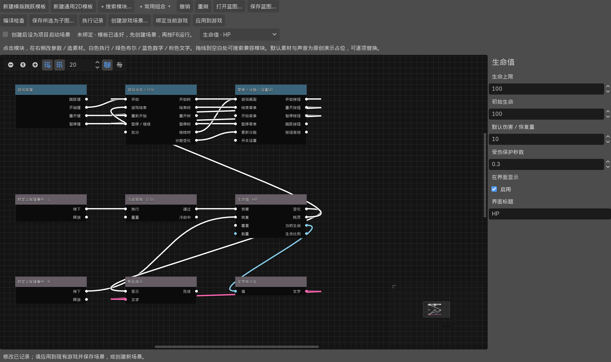
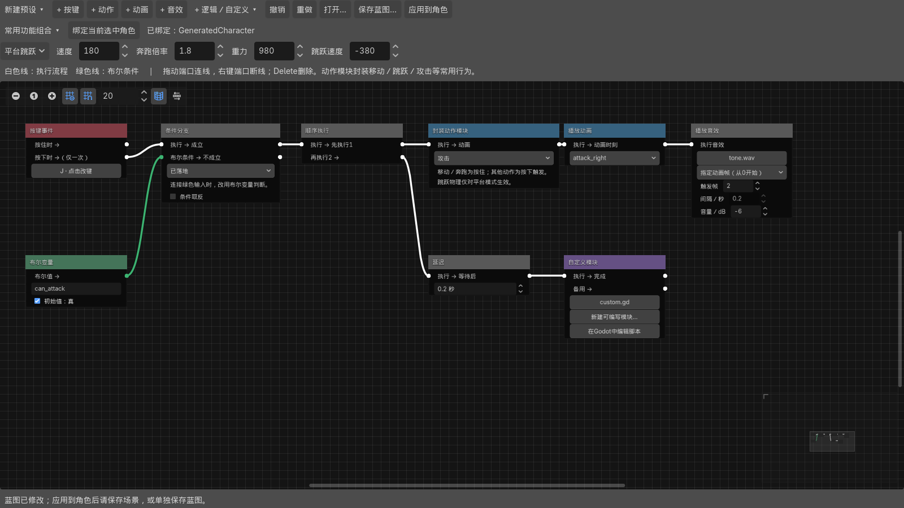

# AlI 蓝图模块手册

版本快照：插件0.5.0-stage1，2026年11月17日。按当前安装模块与运行代码核对。

本轮新增统一资源槽、独立预览、折叠检查器和界面按钮。角色节点参数移至右侧；下方旧截图仅为机制示意。完整范围及未完成阶段见[0.5阶段文档](BLUEPRINT_05_PLAN.md)。

## 先看这份总览

目前有两个独立工作台：游戏蓝图41类模块，角色蓝图10类模块。部分能力重复，属于各自工作台的模块。角色动作菜单有19个选项，这些是一个动作模块内的选项；游戏字段定义共148项。

| 工作台 | 打开入口 | 适合做什么 |
| --- | --- | --- |
| 游戏蓝图 | Godot右侧AlI素材 → 游戏蓝图／创建小游戏 | 整局跑酷，或通用2D场景、变量、流程、状态、生命值与场景交互 |
| 角色蓝图 | Godot右侧AlI素材 → 角色蓝图工作台 | 配置单个角色的按键、已有动画、动作信号与动画音效 |

蓝图负责组织游戏逻辑和播放素材。图片、动画帧、音乐和音效由用户生成或导入后选择。当前小恐龙示例里的默认图形和声音是代码制作的演示占位，并非全部通过AI模型生成。

白色端口连接执行流程，绿色布尔、蓝色数字、粉色文字连接对应的数据。端口编号从0开始；下列数字是连线位置，参数中也出现0时不要与端口混淆。

## 游戏蓝图：41类模块一览

| 模块 | 主要用途 | 数量规则 |
| --- | --- | --- |
| 游戏状态／计分 | 管理一局游戏的开始、结束、暂停、继续、重开和分数；保存最高分。 | 核心模块：保留一个 |
| 游戏按键 | 将实际按键转换成开始、跳跃、重开或暂停事件。默认Space在开始菜单用于开始，在结束后用于重开。 | 核心模块：保留一个 |
| 自动奔跑角色 | 横版跑酷角色控制：固定横向位置，地面和障碍滚动；包含落地判断、单次跳跃、行走动画、死亡动画及脚步事件。 | 跑酷核心；通用2D可省略 |
| 背景／地面滚动 | 创建可碰撞地面、显示背景并滚动背景／地面；可选贴图或默认绘制。 | 跑酷核心；通用2D可省略 |
| 障碍生成／碰撞 | 生成矩形碰撞障碍，向角色方向滚动，检测碰撞和越过事件；可以随时间加速。 | 跑酷核心；通用2D可省略 |
| 菜单／分数／设置UI | 建立标题、分数、开始／暂停／结束／重开菜单和音量滑条；支持Logo、面板、按钮贴图及文字替换。 | 核心模块：保留一个 |
| 音频总线混音 | 集中控制本局Master、BGM、SFX、UI四路音量；运行时音量设置可保存。它是配置模块，没有执行连线端口。 | 核心模块：保留一个 |
| 画面比例 | 设置基础画面宽高、保持比例或扩展可见区域、最近邻采样。它是配置模块，没有执行连线端口。 | 核心模块：保留一个 |
| 播放声音 | 播放已有声音，指定输出总线、独立音量、循环和有限声音池；也可选择演示音色。 | 可添加多个实例 |
| 计时器 | 启动后按间隔发出事件，可重复或单次；只在游戏进行中计时，暂停时冻结。 | 可添加多个实例 |
| 条件分支 | 判断条件后选择成立／不成立出口；连接绿色输入时，使用布尔变量替代内置判断。 | 可添加多个实例 |
| 顺序执行 | 在同一次事件中依次触发两路执行线；不会等待第一路的动画或延迟完成。 | 可添加多个实例 |
| 延迟 | 等待指定时间后继续，游戏暂停时冻结等待。 | 可添加多个实例 |
| 布尔变量 | 提供可命名的真假变量，绿色输出连接条件分支；自定义模块也可修改该变量。 | 可添加多个实例 |
| 自定义模块 | 选择或编写项目GDScript，在执行线到达时调用execute(context)，返回完成或备用出口。 | 可添加多个实例 |
| 界面按钮 | 创建或绑定原生Button／TextureButton，集中配置四状态贴图、悬停／点击音效与五类交互事件。 | 可添加多个实例 |
| 黑板变量 | 保存本游戏的布尔、数字或文字变量，按需读取；可选择重开恢复初始值。 | 可添加多个实例 |
| 写入变量 | 执行线到达时，把数据输入或默认值写入指定黑板变量。 | 可添加多个实例 |
| 数字常量 | 输出固定数字。 | 可添加多个实例 |
| 文字常量 | 输出固定文字。 | 可添加多个实例 |
| 数字运算 | 对两路数字进行加、减、乘、除、取小或取大。 | 可添加多个实例 |
| 数字比较 | 比较两路数字，输出布尔值。 | 可添加多个实例 |
| 布尔运算 | 组合布尔条件：同时成立、至少一个成立或取反。 | 可添加多个实例 |
| 读取游戏数据 | 读取分数、最高分、当前局秒数、滚动速度或帧间隔。 | 可添加多个实例 |
| 只执行一次 | 只允许一次执行通过，直到重置或重开。 | 可添加多个实例 |
| 执行闸门 | 根据开关决定执行线是否通过。 | 可添加多个实例 |
| 交替执行 | 每次执行交替选择A、B，同时提供本次是否为A。 | 可添加多个实例 |
| 冷却限制 | 首次立即通过，冷却结束前再次触发走冷却中出口。 | 可添加多个实例 |
| 状态机 | 管理命名状态机，输出进入／离开事件及当前／上一个状态文字。 | 可添加多个实例 |
| 切换状态 | 请求已有状态机切换到指定状态，走成功或拒绝出口。 | 可添加多个实例 |
| 发送命名事件 | 广播命名事件及文字消息。 | 可添加多个实例 |
| 接收命名事件 | 收到相同名称的广播时发出执行和消息。 | 可添加多个实例 |
| 生命值 | 处理伤害、恢复、生命上限、受伤保护与死亡耗尽事件，并可显示生命条。 | 可添加多个实例 |
| 生成场景实例 | 实例化已有2D场景，设置位置，并限制本模块存活数量。 | 可添加多个实例 |
| 场景节点操作 | 操作游戏根节点下的场景节点：显示、隐藏、启停、删除、位置、速度和动画。 | 可添加多个实例 |
| 场景信号事件 | 监听实际场景节点的Godot信号，并提供首个参数文字。 | 可添加多个实例 |
| 调试记录 | 记录执行经过或输入文字，供排查流程。 | 可添加多个实例 |
| 可复用子图 | 调用保存的可复用子图，等待其出口后继续。 | 可添加多个实例 |
| 自定义按键事件 | 将可修改键位的按下与释放转换为执行事件。 | 可添加多个实例 |
| 文字格式化 | 把数字、文字或布尔值填进文字模板的{value}。 | 可添加多个实例 |
| 界面提示 | 在界面显示短时提示，供状态、拾取、任务反馈使用。 | 可添加多个实例 |

跑酷模板13个节点实例：8个核心加5个声音实例；通用2D模板只有5个核心，不强制带跑酷角色／世界／障碍。另有生命值组合和状态机组合。完整类型化数据、子图与迁移说明见技术文档。

## 游戏模块：入口、出口与全部参数

下列默认值来自当前模块定义；已有游戏场景和用户保存的音量设置可能使用不同数值。音量单位为dB，-60在本模板中按静音处理。跑酷素材未选择时使用原有演示占位；自定义脚本、场景实例、子图模块必须配置对应资源。黑板／写入变量和格式化模块的端口类型会随类型参数改变，表中显示默认数字类型。

### 游戏状态／计分（session）

管理一局游戏的开始、结束、暂停、继续、重开和分数；保存最高分。

输入：0 开始（执行）；1 游戏结束（执行）；2 重新开始（执行）；3 暂停／继续（执行）；4 加分（执行）

输出：0 开始时（执行）；1 结束时（执行）；2 重开时（执行）；3 暂停时（执行）；4 继续时（执行）；5 分数变化（执行）

| 参数 | 默认值 | 可选范围／说明 |
| --- | --- | --- |
| 每秒分数 | 10 | 0 ～ 100 |
| 越过障碍加分 | 10 | 0 ～ 1000 |
| 独立存档名称 | pixel_runner | 文字；输入后按回车确认 |

“加分”入口使用“越过障碍加分”参数；每秒分数单独累计。存档内容目前是最高分与音量，不是完整关卡／背包存档。

### 游戏按键（input）

将实际按键转换成开始、跳跃、重开或暂停事件。默认Space在开始菜单用于开始，在结束后用于重开。

输入：无执行输入。

输出：0 跳跃键（执行）；1 开始键（执行）；2 重开键（执行）；3 暂停键（执行）

| 参数 | 默认值 | 可选范围／说明 |
| --- | --- | --- |
| 跳跃／开始键 | Space | 选择常用键或按键捕获 |
| 暂停键 | Escape | 选择常用键或按键捕获 |
| 重开键 | R | 选择常用键或按键捕获 |

跳跃、暂停、重开需使用不同键。该模块是单键输入，不包含组合键或通用手柄重映射系统。

### 自动奔跑角色（runner）

横版跑酷角色控制：固定横向位置，地面和障碍滚动；包含落地判断、单次跳跃、行走动画、死亡动画及脚步事件。

输入：0 开始／重置（执行）；1 跳跃（执行）；2 死亡（执行）；3 停止（执行）

输出：0 起跳时（执行）；1 落地时（执行）；2 死亡时（执行）；3 死亡动画结束（执行）；4 地面脚步（执行）

| 参数 | 默认值 | 可选范围／说明 |
| --- | --- | --- |
| 角色动画资源 | 未选择 | 项目内角色.tscn／SpriteFrames.tres |
| 行走动画名 | walk_right | 文字；输入后按回车确认 |
| 跳跃动画名 | jump_right | 文字；输入后按回车确认 |
| 死亡动画名 | death_right | 文字；输入后按回车确认 |
| 显示高度 | 84 | 16 ～ 300 |
| 碰撞宽度 | 38 | 4 ～ 200 |
| 碰撞高度 | 68 | 4 ～ 280 |
| 重力 | 1600 | 300 ～ 4000 |
| 起跳速度 | -640 | -1500 ～ -200 |
| 地面脚步间隔／秒 | 0.22 | 0.08 ～ 2 |

角色资源支持SpriteFrames.tres或含SpriteFrames的角色asset.tscn；需要行走、跳跃、死亡三种动画。不包含二段跳、下蹲、攀墙、攻击判定或敌人AI。

### 背景／地面滚动（world）

创建可碰撞地面、显示背景并滚动背景／地面；可选贴图或默认绘制。

输入：0 开始／重置（执行）；1 停止（执行）

输出：无执行输出。

| 参数 | 默认值 | 可选范围／说明 |
| --- | --- | --- |
| 背景贴图 | 未选择 | 项目内图片 |
| 地面贴图 | 未选择 | 项目内图片 |
| 背景颜色 | #dceef0 | 颜色 |
| 地面颜色 | #183d45 | 颜色 |
| 地面高度位置 | 0.8 | 0.55 ～ 0.9 |
| 背景滚动倍率 | 0.15 | 0 ～ 1 |

提供跑酷用的平面地面和横向滚动，不是TileMap关卡编辑器、地形生成器或摄像机跟随系统。

### 障碍生成／碰撞（spawner）

生成矩形碰撞障碍，向角色方向滚动，检测碰撞和越过事件；可以随时间加速。

输入：0 开始／清空（执行）；1 停止（执行）

输出：0 碰到角色（执行）；1 越过障碍（执行）

| 参数 | 默认值 | 可选范围／说明 |
| --- | --- | --- |
| 障碍贴图 | 未选择 | 项目内图片 |
| 初始滚动速度 | 300 | 80 ～ 800 |
| 最高速度 | 500 | 80 ～ 1000 |
| 每秒加速 | 3 | 0 ～ 30 |
| 最短生成间隔／秒 | 1.5 | 0.3 ～ 8 |
| 最长生成间隔／秒 | 2.4 | 0.3 ～ 10 |
| 障碍宽度 | 36 | 10 ～ 160 |
| 障碍高度 | 58 | 10 ～ 200 |
| 自动限制障碍高度与间距 | 开启 | 开关 |

打开自动限制时，会按跳跃能力限制障碍高度与间距。复杂轮廓、飞行敌人、机关和拾取物需另行扩展。

### 菜单／分数／设置UI（hud）

建立标题、分数、开始／暂停／结束／重开菜单和音量滑条；支持Logo、面板、按钮贴图及文字替换。

输入：0 游戏画面（执行）；1 结束菜单（执行）；2 开始菜单（执行）；3 暂停菜单（执行）；4 更新分数（执行）；5 开关设置（执行）

输出：0 开始按钮（执行）；1 重开按钮（执行）；2 暂停按钮（执行）；3 跳跃按钮（执行）；4 按钮音效（执行）

| 参数 | 默认值 | 可选范围／说明 |
| --- | --- | --- |
| 游戏标题 | PIXEL RUN | 文字；输入后按回车确认 |
| 标题图片 | 未选择 | 项目内图片 |
| 面板贴图（九宫格） | 未选择 | 项目内图片 |
| 按钮普通贴图 | 未选择 | 项目内图片 |
| 按钮悬停贴图 | 未选择 | 项目内图片 |
| 按钮按下贴图 | 未选择 | 项目内图片 |
| 显示触屏跳跃按钮 | 开启 | 开关 |
| 开始按钮文字 | START | 文字；输入后按回车确认 |
| 重开按钮文字 | RETRY | 文字；输入后按回车确认 |
| 暂停按钮文字 | PAUSE | 文字；输入后按回车确认 |
| 继续按钮文字 | RESUME | 文字；输入后按回车确认 |
| 结束标题 | GAME OVER | 文字；输入后按回车确认 |
| 跳跃按钮文字 | JUMP | 文字；输入后按回车确认 |
| 声音设置文字 | AUDIO | 文字；输入后按回车确认 |
| 关闭按钮文字 | CLOSE | 文字；输入后按回车确认 |
| 分数标签 | SCORE | 文字；输入后按回车确认 |
| 最高分标签 | BEST | 文字；输入后按回车确认 |
| 标题说明 | Jump. Avoid. Try again. | 文字；输入后按回车确认 |

支持的是预设菜单和HUD，不是任意UI可视化排版工具。面板／按钮使用默认8像素九宫格边缘；复杂界面仍可在Godot中制作。

### 音频总线混音（mixer）

集中控制本局Master、BGM、SFX、UI四路音量；运行时音量设置可保存。它是配置模块，没有执行连线端口。

输入：无执行输入。

输出：无执行输出。

| 参数 | 默认值 | 可选范围／说明 |
| --- | --- | --- |
| 总音量／dB | 0 | -60 ～ 6 |
| 背景音乐／dB | -12 | -60 ～ 6 |
| 游戏音效／dB | -4 | -60 ～ 6 |
| 界面声音／dB | -8 | -60 ～ 6 |

Master是本局总音量，BGM是音乐，SFX是游戏音效，UI是按钮声音。私有总线在退出场景时清理，不覆盖项目原有Master设置。

### 画面比例（screen）

设置基础画面宽高、保持比例或扩展可见区域、最近邻采样。它是配置模块，没有执行连线端口。

输入：无执行输入。

输出：无执行输出。

| 参数 | 默认值 | 可选范围／说明 |
| --- | --- | --- |
| 基础画面宽度 | 960 | 480 ～ 3840；整数 |
| 基础画面高度 | 540 | 240 ～ 2160；整数 |
| 画面适配 | 保持比例／黑边 | 扩展可见区域／保持比例／黑边 |
| 像素最近邻显示 | 开启 | 开关 |

常用值：960×540（16:9）、800×600（4:3）、540×960（竖屏）。改变采样方式不会把普通插画自动变成像素画。

### 播放声音（audio）

播放已有声音，指定输出总线、独立音量、循环和有限声音池；也可选择演示音色。

输入：0 播放（执行）；1 停止（执行）；2 暂停（执行）；3 继续（执行）

输出：0 播放结束（执行）

| 参数 | 默认值 | 可选范围／说明 |
| --- | --- | --- |
| 音频文件 | 未选择 | 项目内WAV／OGG／MP3 |
| 输出总线 | 游戏音效 | 背景音乐／游戏音效／界面声音 |
| 循环播放 | 关闭 | 开关 |
| 独立音量／dB | 0 | -60 ～ 6 |
| 同时播放数量 | 2 | 1 ～ 8；整数 |
| 空文件时使用演示音色 | 演示跳跃 | 演示按钮／演示死亡／演示跳跃／演示配乐／静音／演示脚步 |

同一类型可以添加多个实例。默认图的music、steps、jump_sfx、death_sfx、click是五个实例，不是五种新的模块类型。空文件时按演示音色设置播放或静音；循环不会自动修复文件首尾接缝。

### 计时器（timer）

启动后按间隔发出事件，可重复或单次；只在游戏进行中计时，暂停时冻结。

输入：0 启动（执行）；1 停止（执行）；2 重置（执行）

输出：0 到时（执行）

| 参数 | 默认值 | 可选范围／说明 |
| --- | --- | --- |
| 间隔／秒 | 1 | 0.01 ～ 120 |
| 重复 | 开启 | 开关 |

“重置”将已计时间归零，保留当前启停状态。重开一局会清理旧计时，开始线可重新启动计时器。

### 条件分支（branch）

判断条件后选择成立／不成立出口；连接绿色输入时，使用布尔变量替代内置判断。

输入：0 判断（执行）；1 布尔条件（布尔）

输出：0 成立（执行）；1 不成立（执行）

| 参数 | 默认值 | 可选范围／说明 |
| --- | --- | --- |
| 判断条件 | 游戏进行中 | 游戏已结束／角色已落地／游戏已暂停／游戏进行中／达到分数 |
| 分数阈值 | 100 | 0 ～ 100000 |

内置条件：游戏进行中、角色已落地、游戏已结束、游戏已暂停、达到分数。可以连接数字比较等布尔输出；游戏图另外支持数字和文字数据。

### 顺序执行（sequence）

在同一次事件中依次触发两路执行线；不会等待第一路的动画或延迟完成。

输入：0 执行（执行）

输出：0 先执行1（执行）；1 再执行2（执行）

无额外参数，通过连线决定执行内容。

需要等待时，在分支上插入延迟模块，或使用死亡动画结束／音频结束等事件。

### 延迟（delay）

等待指定时间后继续，游戏暂停时冻结等待。

输入：0 执行（执行）

输出：0 等待后（执行）

| 参数 | 默认值 | 可选范围／说明 |
| --- | --- | --- |
| 等待／秒 | 0.5 | 0.01 ～ 120 |

等待不阻塞主线程。游戏工作台与角色工作台的时间范围不同，见后文。

### 布尔变量（boolean）

提供可命名的真假变量，绿色输出连接条件分支；自定义模块也可修改该变量。

输入：无执行输入。

输出：0 布尔值（布尔）

| 参数 | 默认值 | 可选范围／说明 |
| --- | --- | --- |
| 变量名称 | can_act | 文字；输入后按回车确认 |
| 初始值 | 开启 | 开关 |

变量名需有效且不重复。它不是通用数字／字符串变量节点。

### 自定义模块（custom）

选择或编写项目GDScript，在执行线到达时调用execute(context)，返回完成或备用出口。

输入：0 执行（执行）

输出：0 完成（执行）；1 备用（执行）

| 参数 | 默认值 | 可选范围／说明 |
| --- | --- | --- |
| 模块脚本 | 未选择 | 项目内RefCounted GDScript |

继承RefCounted，提供同步execute(context)方法。可使用game、actor、variables、score、delta；返回output=0或1。一般跑酷模板无需写此模块。

### 界面按钮（button）

创建或绑定原生Button／TextureButton，集中配置四状态贴图、悬停／点击音效与五类交互事件。

输入：0 启用（执行）；1 禁用（执行）；2 显示（执行）；3 隐藏（执行）；4 点击（执行）

输出：0 点击时（执行）；1 按下时（执行）；2 释放时（执行）；3 鼠标进入（执行）；4 鼠标离开（执行）

| 参数 | 默认值 | 可选范围／说明 |
| --- | --- | --- |
| 绑定现有按钮（空则创建） |  | 文字；输入后按回车确认 |
| 新建控件类型 | Button文字按钮 | Button文字按钮／TextureButton图片按钮 |
| 文字 | BUTTON | 文字；输入后按回车确认 |
| 初始禁用 | 关闭 | 开关 |
| 新建位置X | 60 | -10000 ～ 10000 |
| 新建位置Y | 60 | -10000 ～ 10000 |
| 新建宽度 | 200 | 1 ～ 4096 |
| 新建高度 | 64 | 1 ～ 4096 |
| 普通贴图 | 未选择 | 项目内图片 |
| 悬停贴图 | 未选择 | 项目内图片 |
| 按下贴图 | 未选择 | 项目内图片 |
| 禁用贴图 | 未选择 | 项目内图片 |
| 悬停音效 | 未选择 | 项目内WAV／OGG／MP3 |
| 点击音效 | 未选择 | 项目内WAV／OGG／MP3 |
| 独立音量／dB | -8 | -60 ～ 6 |
| 输出总线 | 界面声音 | 背景音乐／总线／游戏音效／界面声音 |

空状态图沿用普通图；空目标创建新控件，已有目标保留原生布局。禁用不发出蓝图事件。预览在独立副本中进行。按钮动画与通用Tween任务将在后续阶段提供，详见0.5阶段文档。

### 黑板变量（blackboard）

保存本游戏的布尔、数字或文字变量，按需读取；可选择重开恢复初始值。

输入：无执行输入。

输出：0 当前值（数字）

| 参数 | 默认值 | 可选范围／说明 |
| --- | --- | --- |
| 变量名 | value | 文字；输入后按回车确认 |
| 类型 | 数字 | 布尔／数字／文字 |
| 初始数字 | 0 | -1000000 ～ 1000000 |
| 初始文字 |  | 文字；输入后按回车确认 |
| 初始布尔值 | 关闭 | 开关 |
| 新一局恢复初始值 | 开启 | 开关 |

只显示所选类型的初值；变量名不可重复。存储范围是本游戏实例，默认不写存档。

### 写入变量（set_variable）

执行线到达时，把数据输入或默认值写入指定黑板变量。

输入：0 写入（执行）；1 值（数字）

输出：0 完成（执行）

| 参数 | 默认值 | 可选范围／说明 |
| --- | --- | --- |
| 变量名 | value | 文字；输入后按回车确认 |
| 类型 | 数字 | 布尔／数字／文字 |
| 默认数字 | 0 | -1000000 ～ 1000000 |
| 默认文字 |  | 文字；输入后按回车确认 |
| 默认布尔值 | 关闭 | 开关 |

名称和类型必须与声明一致；完成线下游立刻读取新值。

### 数字常量（number）

输出固定数字。

输入：无执行输入。

输出：0 数字（数字）

| 参数 | 默认值 | 可选范围／说明 |
| --- | --- | --- |
| 数字 | 1 | -1000000 ～ 1000000 |

纯数据节点，接上执行动作的数据入口才会求值。

### 文字常量（text）

输出固定文字。

输入：无执行输入。

输出：0 文字（文字）

| 参数 | 默认值 | 可选范围／说明 |
| --- | --- | --- |
| 文字 | Hello | 文字；输入后按回车确认 |

适合命名事件消息、界面提示和调试文字。

### 数字运算（math）

对两路数字进行加、减、乘、除、取小或取大。

输入：0 A（数字）；1 B（数字）

输出：0 结果（数字）

| 参数 | 默认值 | 可选范围／说明 |
| --- | --- | --- |
| 计算 | 加 | 加／除／取大／取小／乘／减 |
| 未接线时A | 0 | -1000000 ～ 1000000 |
| 未接线时B | 1 | -1000000 ～ 1000000 |

未接线用参数；除零或溢出记入调试记录，结果为0。

### 数字比较（compare）

比较两路数字，输出布尔值。

输入：0 A（数字）；1 B（数字）

输出：0 结果（布尔）

| 参数 | 默认值 | 可选范围／说明 |
| --- | --- | --- |
| 比较 | 大于 | 近似相等／大于／大于等于／小于／小于等于 |
| 未接线时A | 0 | -1000000 ～ 1000000 |
| 未接线时B | 1 | -1000000 ～ 1000000 |

可接条件分支；相等使用浮点近似比较。

### 布尔运算（logic）

组合布尔条件：同时成立、至少一个成立或取反。

输入：0 A（布尔）；1 B（布尔）

输出：0 结果（布尔）

| 参数 | 默认值 | 可选范围／说明 |
| --- | --- | --- |
| 逻辑 | 同时成立 | 同时成立／A不成立／至少一个成立 |
| 未接线时A | 关闭 | 开关 |
| 未接线时B | 关闭 | 开关 |

取反只使用A；数据循环会在编译时拒绝。

### 读取游戏数据（game_value）

读取分数、最高分、当前局秒数、滚动速度或帧间隔。

输入：无执行输入。

输出：0 值（数字）

| 参数 | 默认值 | 可选范围／说明 |
| --- | --- | --- |
| 数据 | 分数 | 最高分／滚动速度／帧间隔／本局秒数／分数 |

输出为数字，不会触发执行。

### 只执行一次（do_once）

只允许一次执行通过，直到重置或重开。

输入：0 执行（执行）；1 重置（执行）

输出：0 通过（执行）

| 参数 | 默认值 | 可选范围／说明 |
| --- | --- | --- |
| 初始关闭 | 关闭 | 开关 |

初始关闭时，先连接重置端口打开；重置始终重新允许一次通过。

### 执行闸门（gate）

根据开关决定执行线是否通过。

输入：0 执行（执行）；1 打开（执行）；2 关闭（执行）；3 切换（执行）

输出：0 通过（执行）

| 参数 | 默认值 | 可选范围／说明 |
| --- | --- | --- |
| 初始打开 | 开启 | 开关 |

打开、关闭和切换只改变闸门状态；不会自行触发通过。

### 交替执行（flip_flop）

每次执行交替选择A、B，同时提供本次是否为A。

输入：0 执行（执行）；1 重置（执行）

输出：0 A（执行）；1 B（执行）；2 本次为A（布尔）

无额外参数，通过连线决定执行内容。

重置后下一次走A；A为端口0，B为端口1。

### 冷却限制（cooldown）

首次立即通过，冷却结束前再次触发走冷却中出口。

输入：0 执行（执行）；1 重置（执行）

输出：0 通过（执行）；1 冷却中（执行）

| 参数 | 默认值 | 可选范围／说明 |
| --- | --- | --- |
| 冷却秒数 | 0.5 | 0.01 ～ 120 |

暂停冻结冷却；重置或重开清除冷却。

### 状态机（fsm）

管理命名状态机，输出进入／离开事件及当前／上一个状态文字。

输入：0 重置（执行）

输出：0 进入状态（执行）；1 当前状态（文字）；2 离开状态（执行）；3 上一状态（文字）

| 参数 | 默认值 | 可选范围／说明 |
| --- | --- | --- |
| 状态机名 | player_state | 文字；输入后按回车确认 |
| 状态（逗号分隔） | idle,move,attack,dead | 文字；输入后按回车确认 |
| 初始状态 | idle | 文字；输入后按回车确认 |
| 允许转换（空表示任意已知状态） |  | 文字；输入后按回车确认 |

状态用英文标识符、逗号分隔；转换如idle>attack;attack>idle。首次开始发出初始进入事件。

### 切换状态（set_state）

请求已有状态机切换到指定状态，走成功或拒绝出口。

输入：0 执行（执行）

输出：0 成功（执行）；1 拒绝（执行）

| 参数 | 默认值 | 可选范围／说明 |
| --- | --- | --- |
| 状态机名 | player_state | 文字；输入后按回车确认 |
| 目标状态 | move | 文字；输入后按回车确认 |

当前状态等于目标时按成功处理，但不再发出进入／离开事件。

### 发送命名事件（event_emit）

广播命名事件及文字消息。

输入：0 发送（执行）；1 消息（文字）

输出：0 已发送（执行）

| 参数 | 默认值 | 可选范围／说明 |
| --- | --- | --- |
| 事件名 | collected | 文字；输入后按回车确认 |
| 消息 |  | 文字；输入后按回车确认 |

名称相同的监听模块都能收到；消息会随本次执行链保存。

### 接收命名事件（event_listener）

收到相同名称的广播时发出执行和消息。

输入：无执行输入。

输出：0 收到（执行）；1 消息（文字）

| 参数 | 默认值 | 可选范围／说明 |
| --- | --- | --- |
| 事件名 | collected | 文字；输入后按回车确认 |

游戏实例之间隔离；子图事件名仍为全局本游戏事件，需自行避免命名冲突。

### 生命值（health）

处理伤害、恢复、生命上限、受伤保护与死亡耗尽事件，并可显示生命条。

输入：0 伤害（执行）；1 恢复（执行）；2 重置（执行）；3 数量（数字）

输出：0 变化（执行）；1 耗尽（执行）；2 当前生命（数字）；3 生命比例（数字）

| 参数 | 默认值 | 可选范围／说明 |
| --- | --- | --- |
| 生命上限 | 100 | 1 ～ 1000000 |
| 初始生命 | 100 | 0 ～ 1000000 |
| 默认伤害／恢复量 | 10 | 0 ～ 1000000 |
| 受伤保护秒数 | 0.3 | 0 ～ 60 |
| 在界面显示 | 开启 | 开关 |
| 界面标题 | HP | 文字；输入后按回车确认 |

耗尽只在正数降到0时触发；0生命不能用恢复复活，需重置。不自动生成攻击范围或命中碰撞体。

### 生成场景实例（spawn_scene）

实例化已有2D场景，设置位置，并限制本模块存活数量。

输入：0 生成（执行）；1 清理本模块实例（执行）；2 X（数字）；3 Y（数字）

输出：0 成功（执行）；1 失败（执行）

| 参数 | 默认值 | 可选范围／说明 |
| --- | --- | --- |
| 场景文件 | 未选择 | 项目内2D PackedScene.tscn |
| 实例名称 | Entity | 文字；输入后按回车确认 |
| X | 200 | -100000 ～ 100000 |
| Y | 200 | -100000 ～ 100000 |
| 最多存活实例 | 16 | 1 ～ 64；整数 |

可选择AlI导出的角色场景；最多64个实例。重开清理本模块实例；重名时Godot分配不同名称。

### 场景节点操作（node_action）

操作游戏根节点下的场景节点：显示、隐藏、启停、删除、位置、速度和动画。

输入：0 执行（执行）；1 X（数字）；2 Y（数字）

输出：0 成功（执行）；1 失败（执行）

| 参数 | 默认值 | 可选范围／说明 |
| --- | --- | --- |
| 目标路径（相对游戏根节点） | Entity | 文字；输入后按回车确认 |
| 操作 | 显示 | 播放动画／禁用处理／启用处理／删除／隐藏／设置位置／显示／移动距离／设置角色速度 |
| X | 0 | -100000 ～ 100000 |
| Y | 0 | -100000 ～ 100000 |
| 动画名 | idle | 文字；输入后按回车确认 |

必须相对路径；速度要求CharacterBody2D且自身控制器实际消费速度。动画要求AnimatedSprite2D或AnimationPlayer。不能删除内建游戏核心节点。

### 场景信号事件（signal_event）

监听实际场景节点的Godot信号，并提供首个参数文字。

输入：无执行输入。

输出：0 触发（执行）；1 首个参数（文字）

| 参数 | 默认值 | 可选范围／说明 |
| --- | --- | --- |
| 目标路径（相对游戏根节点） | Entity | 文字；输入后按回车确认 |
| 信号名 | tree_exiting | 文字；输入后按回车确认 |

支持0到4参数的信号，额外参数忽略；开始时及每次生成场景后绑定。目标稍后由外部脚本创建时，需调用重新绑定。

### 调试记录（log）

记录执行经过或输入文字，供排查流程。

输入：0 执行（执行）；1 文字（文字）

输出：0 完成（执行）

| 参数 | 默认值 | 可选范围／说明 |
| --- | --- | --- |
| 文字 | Blueprint event | 文字；输入后按回车确认 |

记录限256条；调试构建退出场景时写到本项目user://。

### 可复用子图（module）

调用保存的可复用子图，等待其出口后继续。

输入：0 执行（执行）

输出：0 完成（执行）

| 参数 | 默认值 | 可选范围／说明 |
| --- | --- | --- |
| 子图文件 | 未选择 | 项目内子图JSON |

编译时展开；最多4层，禁止递归。内部声明变量与状态机按调用实例隔离。当前仅一个执行入口／出口，没有公开数据参数口。

### 自定义按键事件（key_event）

将可修改键位的按下与释放转换为执行事件。

输入：无执行输入。

输出：0 按下（执行）；1 释放（执行）

| 参数 | 默认值 | 可选范围／说明 |
| --- | --- | --- |
| 按键 | J | 选择常用键或按键捕获 |
| 仅在游戏进行时触发 | 开启 | 开关 |

默认仅游戏进行时响应；与移动角色的按住输入是不同接口。

### 文字格式化（format_text）

把数字、文字或布尔值填进文字模板的{value}。

输入：0 值（数字）

输出：0 文字（文字）

| 参数 | 默认值 | 可选范围／说明 |
| --- | --- | --- |
| 输入类型 | 数字 | 布尔／数字／文字 |
| 文字（{value}为值） | Value: {value} | 文字；输入后按回车确认 |

先选输入类型，再连相同颜色数据线；数字按Godot默认文字格式显示。

### 界面提示（ui_message）

在界面显示短时提示，供状态、拾取、任务反馈使用。

输入：0 显示（执行）；1 文字（文字）

输出：0 完成（执行）

| 参数 | 默认值 | 可选范围／说明 |
| --- | --- | --- |
| 显示文字 | Complete | 文字；输入后按回车确认 |
| 显示秒数 | 2 | 0.1 ～ 60 |

暂停时冻结剩余显示时长；新提示覆盖旧提示。

## 角色蓝图：10类模块

| 模块 | 输入／输出 | 主要设置与用途 |
| --- | --- | --- |
| 按键事件 | 无输入；0按住、1按下 | 默认新增键F，可点击改键。移动／奔跑通常接按住出口，攻击等通常接按下出口 |
| 事件入口 | 无输入；0事件发生 | 角色就绪、受到伤害、角色死亡、落地、动画结束 |
| 封装动作模块 | 0执行；0动画 | 选择19个动作选项之一；同一种动作只能放一个模块，可由多个按键连接 |
| 播放动画 | 0执行；0动画时刻 | 选择角色已有SpriteFrames动画；没有绑定角色时可填写动画名 |
| 播放音效 | 0执行；无输出 | 选择WAV／OGG／MP3，按开始、指定帧或间隔重复触发 |
| 条件分支 | 0执行、1布尔条件；0成立、1不成立 | 已落地、在空中、正在移动、正在奔跑、始终成立；支持条件取反 |
| 顺序执行 | 0执行；0先执行1、1再执行2 | 在一次触发中依次发出两路，不等待动画结束 |
| 延迟 | 0执行；0等待后 | 默认0.5秒，范围0.01～60秒 |
| 布尔变量 | 无输入；0布尔值 | 名称可改，初始值默认真；绿色线接条件输入 |
| 自定义模块 | 0执行；0完成、1备用 | 选择／新建RefCounted GDScript，在Godot中编辑并复用 |

### 角色音效模块的参数

| 参数 | 默认值 | 范围／说明 |
| --- | --- | --- |
| 触发方式 | 动画开始时 | 动画开始、指定帧、间隔重复 |
| 触发帧 | 0 | 从0开始，必须在所连动画帧数内 |
| 重复间隔 | 0.35秒 | 0.05～60秒 |
| 音量 | 0dB | -60～6dB |

指定帧和重复音效直接接动画模块；普通执行线接音效时使用开始触发。角色音效为2D位置声音，不提供游戏工作台那样的四组全局混音面板。

### 角色工作台全局参数

| 参数 | 默认值 | 范围／说明 |
| --- | --- | --- |
| 角色模式 | 双向移动 | 双向、四向、平台跳跃 |
| 速度 | 180 | 1～2000 |
| 奔跑倍率 | 1.8 | 1～5 |
| 重力 | 980 | 0～10000；平台模式使用 |
| 跳跃速度 | -380 | -3000～-1；负值代表向上 |

## 角色动作选项：哪些已经实现控制逻辑

| 动作选项 | 当前提供的行为 |
| --- | --- |
| 左移、右移、上移、下移 | 控制移动；上／下移动用于四向模式 |
| 待机、行走、奔跑 | 已有动画切换；奔跑带速度倍率 |
| 跳跃 | 平台模式含落地判断和物理跳跃；平面模式只播放跳跃动画 |
| 攻击 | 攻击动画和攻击请求信号；不自动计算伤害或攻击范围 |
| 受击、死亡 | 动画、信号与死亡停止移动；不包含完整生命值系统 |
| 冲刺、翻滚、防御、施法、交互、攀爬、下落、落地 | 提供动作槽、已有动画播放和动作请求接口；对应特殊物理、伤害、技能效果等需要项目代码 |

动作选项不会自动生成相应动作帧。四向角色仍需提供真实的四向素材，不能把一段动画自动变成四个正确方向。

## 现成预设与组合

| 位置 | 当前提供 |
| --- | --- |
| 游戏蓝图 | 横版跑酷、通用2D模板；生命值／受伤／恢复／死亡组合、状态机／攻击冷却示例 |
| 角色新建预设 | 双向移动、四向移动、平台跳跃 |
| 角色常用组合 | 攻击＋指定帧音效、落地才能攻击、按键延迟攻击 |

这些是预设组合，不是额外的新模块类型。组合插入后仍可改键、选动画、选声音和改线。

## 可以直接照连的例子

1. 小恐龙：游戏开始 → 自动奔跑角色开始、背景开始、障碍开始、BGM播放；障碍碰到角色 → 游戏结束；死亡动画结束 → 结束菜单。
2. 脚步声：角色的地面脚步出口 → 声音播放；起跳／游戏结束 → 脚步声音停止。
3. 定时提示：游戏开始 → 计时器启动；计时器到时 → 达到分数条件 → 声音播放。
4. 单个角色攻击：按键按下 → 已落地条件 → 攻击动作 → 攻击动画 → 指定帧音效。

## 两个工作台的差别与使用边界

| 对比 | 游戏蓝图 | 角色蓝图 |
| --- | --- | --- |
| 当前主要目标 | 跑酷与基础通用2D玩法组合 | 单个2D角色的动作控制 |
| 最大模块／连线 | 256／800（含子图展开） | 200／400 |
| 延迟范围 | 0.01～120秒 | 0.01～60秒 |
| 计时器模块 | 有 | 无独立计时器模块 |
| 条件判断 | 进行中、落地、结束、暂停、分数 | 落地、空中、移动、奔跑、始终成立；可取反 |
| 音频 | BGM／SFX／UI总线、循环与有限声音池 | 动画帧对齐与位置音效 |
| 自定义接口 | game、actor、variables、score、delta | actor、variables、delta |

游戏图现在包含三种数据、运算、生命条、状态机与场景／信号接口；尚无完整背包、装备、任务／对话编辑器、商店、敌人AI行为树、完整战斗、摄像机跟随、TileMap关卡编辑或多人网络模块。这些不能作为“已有模块”计入清单，需用自定义脚本或Godot现有功能扩展。

## 保存后如何让修改生效

1. 游戏工作台选择游戏根节点，绑定后修改，点击应用到游戏，再保存场景。也可创建新游戏场景，保留原有文件。
2. 角色工作台选择新版导出的角色根节点，绑定后修改，点击应用到角色，再保存场景。
3. 保存JSON只保存蓝图草稿，不会自动改变运行场景。运行时不自动调用AI生成新素材。

这份手册是当前0.5第一阶段的功能清单。默认跑酷示例与所用占位素材只用于验证玩法和接线；其它类型游戏、AI素材质量和发行包仍需分别验收。

## 技术说明与参考资料

完整架构、编译规则、子图作用域、验证与迁移见docs/GODOT_BLUEPRINT_TECHNICAL.md及配套离线技术文档。

[UE执行与数据流](https://dev.epicgames.com/documentation/en-us/unreal-engine/basic-scripting-with-blueprints-in-unreal-engine)、[NodeCanvas黑板](https://nodecanvas.paradoxnotion.com/documentation/?section=the-blackboard)、[NodeCanvas状态机](https://nodecanvas.paradoxnotion.com/documentation/?section=fsm-node-reference)。