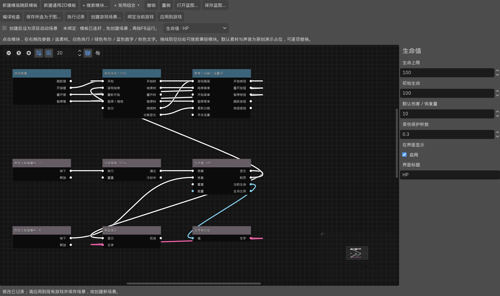

# AlI 基础游戏蓝图技术文档

插件0.4 · 2026年11月16日 · 实测Godot 4.6 stable。

目标是让常见2D小游戏由可连接、可改参数的模块组成，同时保留项目脚本的扩展入口。本版有40类游戏模块和10类角色模块。两套工作台承担整局游戏与单个角色两种职责，部分节点作用相似，不能把数量理解成50套完整玩法。

## 本版交付

| 领域 | 已实现的能力 |
| --- | --- |
| 游戏模板 | 原有完整横版跑酷；新增通用2D场景，不强制带跑酷角色、地面或障碍 |
| 数据 | 本游戏实例黑板；布尔、数字、文字；写入、运算、比较、逻辑、游戏数据读取、文字格式化 |
| 执行控制 | 分支、两路顺序、延迟、计时器、只执行一次、闸门、交替、冷却 |
| 状态与事件 | 命名状态机、允许转换、进入／离开事件、命名广播与独立消息、实际Godot信号 |
| 基础玩法 | 生命上限、伤害、恢复、受伤保护、耗尽事件、生命条；现有场景实例化、数量限制、节点操作 |
| 角色与声音 | 双向／四向／平台角色，移动、奔跑、跳跃、已有动作动画与声音；游戏BGM／SFX／UI混音、暂停与循环 |
| 复用与扩展 | 所选节点保存子图；编译展开、内部变量／状态机隔离；项目GDScript同步自定义模块 |
| 编辑与排错 | 搜索类别／名称、拖线到空白处筛选兼容节点、类型颜色、撤销重做、编译检查、有限执行记录 |



本版没有恢复自动提示词、语言模型、任务拆分或硬件监测。素材仍由用户在AlI手动填写一项要求后生成，再明确选择导出类型与动画片段。蓝图运行本身不调用AI模型。

## 设计参考与取舍

以下是公开官方文档的设计借鉴，没有安装、打包或复制UE、NodeCanvas、Orchestrator的实现。

| 参考 | 文档中的思想 | 本版采用 |
| --- | --- | --- |
| UE Blueprints | 执行线负责先后关系，数据线承载类型化值 | 白色执行流与布尔／数字／文字数据分开；数据按消费时求值。[官方基础文档](https://dev.epicgames.com/documentation/en-us/unreal-engine/basic-scripting-with-blueprints-in-unreal-engine) |
| UE Flow Control | Branch、DoOnce、Gate、FlipFlop等常用流程封装 | 对应分支、只执行一次、闸门、交替及冷却；提供重置端口。[官方流程文档](https://dev.epicgames.com/documentation/en-us/unreal-engine/flow-control-in-unreal-engine) |
| UE最佳实践 | 用事件驱动常见逻辑，复用功能，减少不必要的逐帧工作 | 逻辑只在触发时执行；运行时仅保留物理、计时与显示所需更新。[官方最佳实践](https://dev.epicgames.com/documentation/en-us/unreal-engine/blueprint-best-practices-in-unreal-engine) |
| NodeCanvas黑板 | 图与任务共享有类型的变量 | 游戏实例范围的黑板声明／读值／写入；子图内部声明自动隔离。[官方黑板文档](https://nodecanvas.paradoxnotion.com/documentation/?section=the-blackboard) |
| NodeCanvas FSM | 状态、转换与进入／离开处理 | 命名状态机、初始状态、转换白名单、进入／离开执行口。[官方FSM文档](https://nodecanvas.paradoxnotion.com/documentation/?section=fsm-node-reference) |
| NodeCanvas任务 | 动作与条件分离，可复用；顺序任务需要等待真实完成 | 纯数据条件不改状态；有副作用的节点走执行线；子图只有出口触发后才完成。[官方任务文档](https://nodecanvas.paradoxnotion.com/documentation/?section=tasks-actions-conditions)、[任务列表](https://nodecanvas.paradoxnotion.com/documentation/?section=using-task-lists) |
| Orchestrator | 在Godot内连接节点、类型与信号 | 使用原生GraphEdit和项目资源／信号接口，没有额外GDExtension依赖。[官方项目](https://github.com/CraterCrash/godot-orchestrator) |
| Godot Block Coding | 常见能力做成较高层模块，仍可接触节点与属性 | 保留完整跑酷、角色模板与常用组合；进一步需求接现有场景或自定义代码。[官方使用文档](https://github.com/endlessm/godot-block-coding/blob/main/docs/USAGE.md) |

这里的状态机是实用的扁平FSM，没有NodeCanvas的完整行为树、嵌套FSM、任务生命周期编辑器。执行记录是退出后的快照，没有UE式断点、单步、实时监视与调用栈界面。

## 从空白项目开始

1. 启用AlI素材插件，打开右侧的“游戏蓝图／创建小游戏”。
2. 跑酷直接保留默认模板；其它玩法选择“新建通用2D模板”。
3. 点击“+ 常用组合”，可加入生命值组合，或状态机／攻击冷却示例。组合可以撤销，插入后仍能改线与改键。
4. 点击“编译检查”。检查通过后点击“创建游戏场景”，选择新文件名；只有主动勾选才更换项目启动场景。
5. 按F6运行当前场景。Space开始，Esc暂停，R重开。生命组合J受伤、K恢复；状态示例F进入attack，0.4秒后回到idle。
6. 后续修改时选中游戏根节点，绑定当前游戏，修改、应用到游戏并保存场景。

通用模板的生命／状态示例用于理解机制，没有自动生成战斗动画或命中范围。角色素材可以通过下面的场景接口加入。

## 典型接线

### 角色、动画、攻击与音效

在AlI导出角色场景，先用角色蓝图选择移动方式、键位与已有动画。四向移动必须提供四个真实方向的素材。攻击动作提供动画与请求信号，伤害范围仍需游戏场景中的Area2D／碰撞体或项目脚本。

通用游戏图：游戏开始 → 生成场景实例，选择角色asset.tscn，名称如Player。实例化前设置X／Y；执行数量限制属于该生成模块。节点操作的目标路径如Player、Player/AnimatedSprite2D，必须与运行时实际节点名一致。

监听Player的实际攻击信号 → 生命值伤害；更常见的是监听自己制作的Hitbox命中信号 → 敌人生命值伤害。若只有攻击请求就直接扣血，会没有距离或碰撞判定，这需要制作者明确选择。

需要准确等待时：声音“播放结束” → 下一步；角色“死亡动画结束” → 结束菜单；自定义场景的animation_finished → 后续节点。不要用“两路顺序”假设等待第一条线完成。

### 数值门槛与界面反馈

读取游戏数据（分数） → 数字比较A；比较B填100；比较结果 → 条件分支的绿色条件口。计时器到时 → 分支执行口；成立 → 界面提示或声音播放。

生命值的当前生命（数字） → 文字格式化（数字类型，模板HP: {value}）；格式化输出 → 界面提示的文字输入；生命值变化 → 界面提示的显示入口。生命值本身也可开启预设生命条。

### 状态约束

状态机名player_state，状态idle,attack,dead，初始idle；允许转换idle>attack;attack>idle;idle>dead;attack>dead。

攻击键 → 冷却 → 切换状态attack → 延迟或实际动画完成事件 → 切换idle。生命耗尽 → 切换dead。dead没有回程边时，普通attack请求会走拒绝出口；重开重新进入初始状态。

状态机管理逻辑状态，不会自动播放同名动画。将状态进入出口连接节点操作、声音或项目模块，才能产生相应表现。

## 类型和执行语义

| 颜色／编号 | 含义 | 规则 |
| --- | --- | --- |
| 白／0 | 执行 | 一路可接多个动作；按保存的连线顺序加入先进先出队列 |
| 绿／6 | 布尔 | 比较、逻辑、变量等输出；单个数据输入只有一个来源 |
| 蓝／7 | 数字 | 统一接受整数／浮点，提供给运算、位置、伤害量等 |
| 粉／8 | 文字 | 提示、日志、消息与状态名 |

黑板、写入变量、文字格式化的类型可变。先设置类型再连线；改变类型使已有连线不兼容时会拒绝修改，并保留原有效图。未接数据线时使用节点参数默认值。

纯数据节点在被执行节点读取时求值，不自行触发动作，也不写变量。单次动作内缓存计算结果，下一次动作开始重新读取，因此“写入变量完成 → 条件判断”能读到刚写入的新值。数据环在编译时拒绝，运行求值深度最多64层。

同一次事件最多执行512个请求，超出会丢弃剩余请求并记录故障，防止即时连线环卡死。需要重复执行时使用计时器或显式后续事件。延迟队列最多128项；子图不是无限递归调用。

“顺序执行”是两路触发，不等待动画、声音或延迟返回。等待应通过相应完成事件接线；子图出口可以放在延迟或实际完成事件之后，调用者才会继续。

命名事件的消息及状态切换的前后状态随执行链保存，避免同一帧多次触发时被后一次消息覆盖。一般黑板读值仍代表动作执行时的当前值，不是整局游戏的历史快照。

## 时间、暂停和重开

游戏暂停会冻结世界、跑酷角色动画、计时器、延迟、冷却、生命值受伤保护计时与界面提示时长。由生成场景模块创建的实例暂时禁用处理，恢复后还原原处理模式；UI仍能用于恢复和设置。

自行直接挂在游戏根节点下、未由生成场景模块管理的其它节点，不自动接管其暂停逻辑。项目脚本可以订阅暂停事件实现自己的行为。

重开会取消当前一批待办中的旧延迟，并抑制清理旧实例产生的信号回调；同时清掉延迟和计时器状态、重置流程控制／状态机／生命值、释放本图生成的实例；黑板按“新一局恢复初始值”开关处理。退出清理信号绑定、停止声音和本局私有总线，并还原本局修改的画面缩放设置。

最高分和音量沿用user://独立存档名称；黑板默认不保存到磁盘。不同游戏使用不同save_key，避免共用最高分和设置。

## 可复用子图

1. 先在游戏图中把一段常用动作接好，例如入口日志 → 延迟 → 出口日志。
2. 选中要封装的节点。所选部分需恰好一个来自外部的执行入口和一个通往外部的执行出口。
3. 点击“保存所选为子图”，选择项目内新JSON文件。原连线不会被自动替换。
4. 搜索添加“可复用子图”，选择该文件，再接它的执行入口／完成出口。
5. 编译检查、应用并保存场景。修改子图文件后，要重新编译应用才能更新已保存游戏。

所选范围不能包含游戏核心或独立事件源。跨边界的数据线必须一起选入，首版只公开一个执行入口和出口；更多配置可修改子图源文件，或使用自定义脚本接口。编辑器会拒绝含糊的多入口、多出口，而不是丢掉连线。

编译为每个调用生成独立节点编号；内部声明的黑板变量、旧布尔变量和状态机名称加调用前缀，避免两个实例串值。未在内部声明的全局变量引用仍指向本游戏黑板；命名广播事件也属于本游戏共享事件。最多4层嵌套、64次子图展开，拒绝直接或间接递归；总图仍受256模块／800连线限制。

游戏场景保存编辑原图game_blueprint、展开图compiled_blueprint和规范化原图SHA256 compiled_signature。运行时签名一致就使用展开图，原始子图JSON缺失也能运行；原图改变而签名不符时重新编译。图片、音频和PackedScene资源仍需要打包，不因子图烘焙而自动内嵌。

## 数据格式和代码边界

```json
{
  "version": 1,
  "type": "runner_game",
  "template": "scene2d",
  "nodes": [
    {"id": "hp", "kind": "health", "position": [400, 100], "params": {"max": 100.0, "initial": 100.0, "amount": 10.0, "invulnerability": 0.3, "show": true, "caption": "HP"}}
  ],
  "edges": []
}
```

上面只展示一个节点的结构，不是可以直接运行的完整图：通用2D仍要求session、input、hud、mixer、screen五个核心。无template字段的旧图按跑酷模板解释，另需runner、world、spawner。

| 文件 | 职责 |
| --- | --- |
| game_model.gd | 原有模板与参数、统一类型查询、完整图验证、常用组合 |
| game_registry.gd | 新模块名称、字段、端口类型、搜索类别；供编辑与运行共用 |
| game_window.gd | 原生图编辑、参数、搜索、连线、Undo、编译与子图保存 |
| game_library.gd | 子图读取、边界检查、展开、作用域重命名、签名 |
| game_builder.gd | 新建不覆盖原文件的自含游戏场景与运行依赖 |
| game_runtime.gd | 游戏生命周期、输入、调度、预算、音频与显示资源清理 |
| game_program.gd | 数据求值、流程控制、FSM、生命值、场景／信号及记录 |
| game_actor／world／spawner／audio／hud.gd | 原生物理、跑酷世界与障碍、声音池、容器UI与生命条 |

添加新内建模块需同时定义注册表、端口类型、验证约束与运行行为。仅增加标题不能视作功能完成。外部资源与参考文档内容只作为数据，不作为执行指令。

## 自定义脚本模块

自定义模块是用户主动选择的项目代码，继承RefCounted，提供同步execute(context)方法，返回output为0或1。编辑器只检查接口，不在编辑期实例化用户代码。

```gdscript
extends RefCounted

func execute(context: Dictionary) -> Dictionary:
    var game: Node2D = context["game"]
    game.call("add_points", 10)
    return {"output": 0}
```

context提供game、actor、variables、score、delta。通用2D可能没有跑酷actor，此时为null；场景中生成的其它角色按实际节点路径获取。variables是共享字典，脚本直接写入时需自行遵守声明类型；图内“写入变量”会验证类型。

execute不支持await作为任务完成协议。需要异步时让场景脚本发出Godot信号，图中使用场景信号事件接续。不要在同步接口里使用阻塞等待或无限循环。自定义代码不是沙箱，不承担任意脚本的安全隔离。

场景信号事件支持0到4个参数，额外参数丢弃，首参数转文字；目标在开始和每次图内生成场景后绑定。外部代码延后创建目标，可调用game.get("program").call("bind_signals")重新绑定。固定节点路径不等于对象引用数据口；多实例逐个寻址／遍历可通过项目模块处理。

## 检查、执行记录和限制

编译检查覆盖参数范围、资源存在／类型、变量声明及类型、状态机和转换、端口类型、单一数据来源、数据环、子图递归和容量。逐项报告第一处错误，修好后再次检查。目标场景内的动态节点路径、实际命中逻辑与自定义脚本行为需要运行验证。

调试构建退出场景或执行预算溢出时，写user://ali_blueprint_存档名.json，包含当前游戏状态、变量、FSM、生命值、故障数和最多256条事件。工作台“执行记录”读取最近快照。它不是持续后台监控，也不记录显存或硬件。

| 边界 | 当前范围 |
| --- | --- |
| 游戏图容量 | 最多256模块、800连线，包含子图展开 |
| 运行队列 | 每次事件链512请求；延迟待办128项 |
| 数值 | 编辑参数有字段范围；运行除零／非有限数字记录并取0 |
| 实例 | 每个生成场景模块最多64个活实例；只支持Node2D场景 |
| 音频 | 每个声音实例1～8声部；不自动生成或修复素材接缝 |
| 自定义扩展 | 受控端口调用项目代码；不生成任意脚本 |
| 游戏类别 | 适合2D跑酷与基础事件／状态／场景组合；不是所有游戏类型的零代码引擎 |

尚未提供完整背包／装备、任务／对话编辑器、敌人行为树、弹幕／技能编辑器、完整命中战斗、地图编辑器、摄像机模块、多角色对象遍历或联网同步。可先接Godot已有场景或项目代码，再根据实际游戏验证决定下一批模块；不把NodeCanvas／UE原有功能当成本插件已实现功能。

## 升级与发布

0.3生成的游戏场景带有当时运行脚本副本，安装0.4插件不会暗中覆盖它。升级时绑定旧游戏读取原图，创建另一个新名称场景；旧场景完整保留。工作台会阻止把0.4新图直接应用到旧运行器。原有0.2角色蓝图格式和导出组件继续兼容。

应用0.4游戏时，原图、展开图和签名属于同一步编辑器Undo；撤销不会留下新旧不一致的编译数据。保存草稿JSON不等于应用到场景。

插件可打包为AlI-Godot-addon.zip。用户原空白测试项目只更新插件，不添加测试角色／声音／场景。演示项目另放；示例占位美术和声音是原生代码制作，并非AI生成资产的质量验收。

发行时在Godot安装对应平台导出模板，采用包含实际动态加载资源的导出配置。子图JSON可以不随运行包，但保留源文件便于继续编辑；图片、声音、角色场景和自定义脚本不能漏打包。本轮未下载发行模板，未声称已测试各平台发行包。

## 验证方法

新增原生验证覆盖：三类数据、变量写入后的条件判断、错误类型与数据环拒绝；只执行一次／闸门／交替／冷却；暂停时钟与场景处理；允许／拒绝状态转换；受伤保护和耗尽；同帧独立事件消息；真实PackedScene生成、位置变化、双参数信号；子图编译后缺源文件运行；重开清理与有限记录。

原生编辑器验证覆盖：通用模板及撤销、模块搜索、数据端口颜色／类型、拖线筛选并自动接线、整个添加连线步骤撤销；数值编辑不销毁正在编辑的控件；常用组合、子图保存、创建／绑定场景，以及原图／展开图／签名的统一撤销。

原有跑酷玩法、音频循环、暂停／死亡／重开、资源替换与三种画面比例，以及旧角色蓝图分别回归；使用安装的Godot对脚本和场景做检查。具体本机结果与路径记录在交接文件，不以测试数量代替新游戏或AI素材效果验收。
