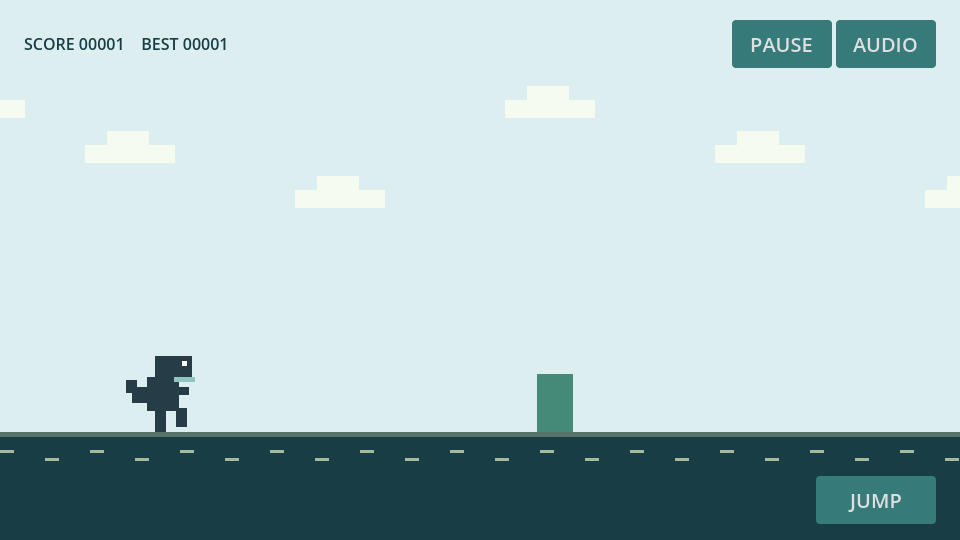
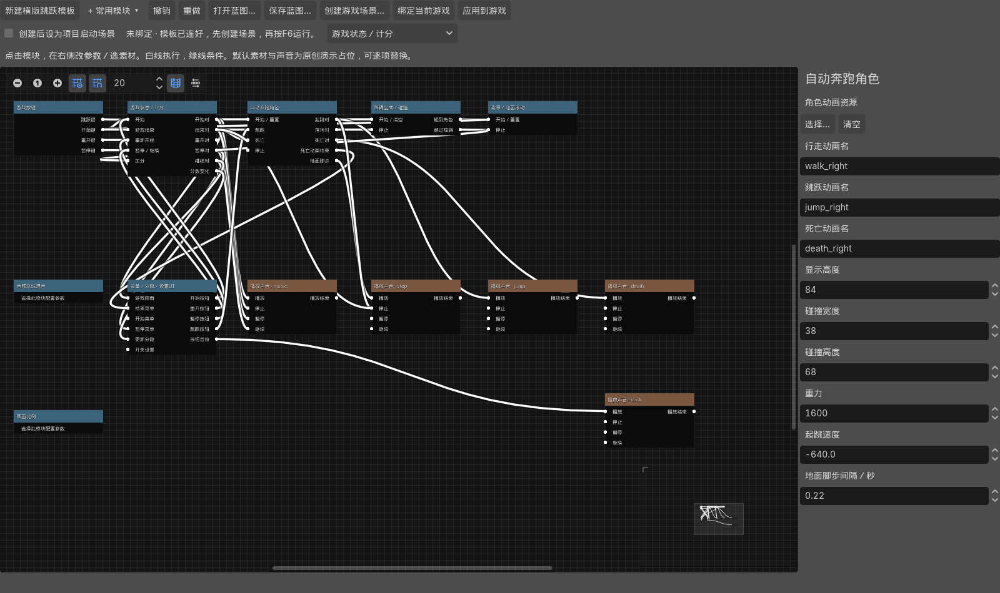
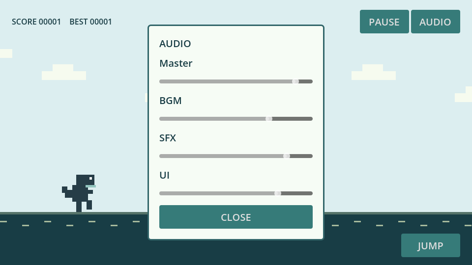

# 用游戏蓝图制作小恐龙式跳跃游戏

0.4补充：跑酷步骤继续适用；其它基础2D玩法可用新增通用模板、生命值／状态机组合。完整模块、子图、类型与升级说明见 [蓝图技术文档](GODOT_BLUEPRINT_TECHNICAL.md) 和 [模块手册](GODOT_BLUEPRINT_CATALOG.md)。

0.5第一阶段补充：资源现可直接拖入右侧折叠参数栏并预览；增加独立界面按钮模块。原自含场景不覆盖，升级需创建新名称场景，详见[0.5阶段文档](BLUEPRINT_05_PLAN.md)。

适用：AlI Godot插件0.3、Godot4.x（本机4.6实际验证）。目标是做出能开始、跳跃躲障碍、计分、死亡、重开的横版小游戏，并配好背景音乐、脚步、跳跃、死亡和按钮声音。常见部分无需自己写GDScript。

## 先做一个能玩的版本

1. 打开Godot项目。现有`AlITestGodot`可以继续使用，原来的空白场景会保留。
2. 在「项目 → 项目设置 → 插件」启用「AlI游戏素材」。已经开着旧版编辑器时，将插件关闭再开启一次。
3. 在右侧「AlI素材」点击「游戏蓝图／创建小游戏…」。这与「角色蓝图工作台」是两个入口：角色窗口只管理一个角色，游戏窗口负责整局游戏。
4. 使用默认「横版跳跃模板」。所有必要连线已接好；先保留演示素材，不必先生成图片或声音。
5. 点击「创建游戏场景…」，保存为`res://games/runner_game.tscn`。需要按F5启动时，先勾选「创建后设为项目启动场景」；没有勾选时，打开这个场景按F6即可运行。重名场景会要求换名称，保留已有文件。
6. 游戏打开后点击START或按Space。Space跳跃，Esc暂停／继续，R重开。碰到障碍后会播放死亡动画，再出现RETRY。
7. 点击AUDIO打开音量设置。Master是总音量，BGM是配乐，SFX是游戏音效，UI是按钮声音。最高分和音量会自动保存在该项目的用户数据中。

创建的场景在编辑器里只有游戏根节点，这是正常的；画面、角色和菜单在运行时根据蓝图搭建。默认角色、界面和短配乐为原创演示占位，便于先试玩法；可以分别替换。



## 如何改蓝图与参数

1. 停止运行，回到游戏场景，选中`RunnerGame`根节点。
2. 打开「游戏蓝图／创建小游戏…」，点击「绑定当前游戏」。
3. 点击画布中的模块，或用上方快速选择框定位模块，在右侧参数栏修改。文字输入后按回车确认；数字、下拉框和开关直接生效于蓝图草稿。
4. 点击「应用到游戏」，再按Ctrl+S保存Godot场景。重新运行后使用新配置。

「保存蓝图…」用于另存一份可复用的JSON；它与保存游戏场景是两件事。应用、参数修改、移动节点、连线和断线均支持撤销／重做。



白色圆点是执行入口／出口；绿色圆点传递布尔条件。拖动端口连接，右键端口断开，选中模块按Delete删除。游戏状态、角色、地面、障碍、UI、混音、按键和画面配置是模板核心模块，需要保留。声音、计时器、分支、顺序、延迟和自定义模块可继续添加。

## 替换成自己生成的素材

建议按「角色 → 背景与障碍 → 声音 → UI」逐项替换；每改一项就运行检查。生成要求仍在AlI里手动填写，每种素材分别生成。

### 角色行走、跳跃和死亡

1. 在AlI的精灵动画功能中分别制作行走、跳跃、死亡。使用同一个角色外观、相同画布和朝向；先检查帧顺序与动作。
2. 点击「导出… → 动画帧／精灵图…」，在原画面里挑选需要的帧，保留「透明背景」。
3. 点「拖入 Godot…」，用途选「动画素材」，再选当前素材对应的动作。点「准备拖入 Godot」后，进度弹窗会显示选中帧的处理状态。
4. 按住「拖入 Godot 蓝图或场景」，拖到现有的「自动奔跑角色」模块。对走路、跳跃和死亡分别操作，模块会保留已接入的其他动作，文件由插件和 AlI 存放到当前项目。
5. 调整显示高度、碰撞宽度和碰撞高度，点击「应用到游戏」并保存场景。

游戏窗口会读取角色的动画资源，使用跑酷专用控制模块；不要求再给角色手写移动脚本，也不需要同时维护两张控制图。这里角色固定在画面左侧，地面和障碍向左滚动。

像素素材建议在生成时明确低分辨率和像素风格，再在导出时设置合适像素高度。最近邻缩放会保留像素边缘，不会把普通插画自动变成正确的像素画。

### 背景、地面、障碍

1. 在AlI单张图片中制作背景、可横向衔接的地面、透明背景障碍。从「Godot → 导出当前图片组件…」准备拖入。
2. 在「背景／地面滚动」的右侧参数栏，把背景和地面分别拖到对应资源槽，设置地面位置及背景滚动倍率。
3. 把障碍拖到「障碍生成／碰撞」模块，调整宽高、初始速度、最高速度、加速度和生成间隔。
4. 首次保留「自动限制障碍高度与间距」开关；它会根据跳跃能力限制高度和间隔，降低配置出明显无法跳过障碍的风险。关闭后完全使用你填写的尺寸与间隔，需自行试玩调节。

PNG障碍会自动配上矩形碰撞区域；复杂轮廓和特殊机关需要自定义模块或Godot场景逻辑。

### 背景音乐和游戏音效

1. 在AlI音频栏目分别生成配乐、脚步、跳跃、死亡、按钮声音，试听后用「Godot → 导出当前音频组件…」准备拖入。
2. 把配乐拖到标题中带`music`的「播放声音」模块，输出总线选「背景音乐」，开启循环。
3. `steps`模块放脚步，`jump_sfx`放跳跃，`death_sfx`放死亡，`click`放按钮声。前三个使用SFX，按钮使用UI总线。
4. 给每个模块设置独立音量，再在「音频总线混音」统一调整四组音量。脚步推荐短音色，可调「自动奔跑角色」里的脚步间隔。
5. 音频文件留空时使用演示音色；选择自己的文件后优先播放该文件。要完全静音，可将演示音色选「静音」，或断开相应执行线。

模板默认已经连好：开始播放BGM，暂停时暂停，继续时恢复，结束时停止；角色在地面奔跑时触发脚步，起跳／死亡时停止脚步，避免长脚步文件拖到空中或结束菜单。声音池数量有上限，退出场景会清理本局创建的音频总线。

循环开关不会自动修复音乐文件的首尾接缝。脚步和按钮声建议短于其触发间隔；过长的文件可先裁剪，否则有限声音池会覆盖旧声音。



### UI素材与文字

1. 在AlI单张图片功能制作标题Logo、菜单面板、按钮普通／悬停／按下三张贴图。每一项分别生成，保留透明背景。
2. 将PNG放进当前项目，在「菜单／分数／设置UI」中选择相应贴图。
3. 按钮文字由UI单独显示，建议底图不画固定文字；可以直接改开始、重开、暂停、继续、结束、音量、跳跃和分数标签。
4. 面板和按钮按九宫格边缘拉伸，默认边缘8像素。建议先用小尺寸、边角清晰的贴图，例如按钮256×80；不要把整张菜单截图当成单个按钮。

分数绑定、开始／重开／暂停按钮事件和声音设置滑条由UI模块负责。首次制作不必手动写按钮信号连接脚本。

### 按键和画面比例

- 「游戏按键」中直接选择常用键，也可点击改键按钮后按键。跳跃／开始、暂停、重开使用不同键；修改后画面操作提示会跟着更新。
- 「画面比例」中填写基础宽高：16:9可用960×540，4:3可用800×600，竖屏可用540×960。
- 「保持比例／黑边」完整保留基础画面；「扩展可见区域」在不同窗口比例下显示更多场景。
- UI随画面布局；窄画面会将顶部控件改成纵向排列。像素最近邻显示开关控制贴图采样。

## 认识默认连线

| 事件 | 执行模块 |
| --- | --- |
| 开始按钮／开始键 | 游戏状态：开始 |
| 游戏开始 | 角色开始、地面开始、障碍开始、显示游戏UI、播放BGM |
| 跳跃键／触屏按钮 | 角色跳跃；角色模块检查是否已落地 |
| 角色起跳 | 跳跃声播放、脚步声停止 |
| 角色地面脚步 | 脚步声播放 |
| 障碍碰到角色 | 游戏状态：结束 |
| 游戏结束 | 角色死亡、障碍和地面停止、BGM与脚步停止 |
| 角色死亡 | 死亡声播放 |
| 死亡动画结束 | 显示结束菜单 |
| 越过障碍／时间累计 | 增加分数并刷新UI |
| 暂停／继续 | 冻结／恢复模拟，切换菜单，暂停／恢复音乐 |

新手可以保留这些线，只改素材和数值。需要新逻辑时再插入模块。例如：

- 定时效果：`游戏开始 → 计时器启动 → 到时 → 播放音效`。
- 条件效果：`计时器到时 → 达到分数条件 → 播放音效`。
- 同时触发：`事件 → 顺序执行 → 输出1／输出2`；两支在同次事件中执行，不会自动等第一段动画播完。
- 等待后触发：`事件 → 延迟 → 后续模块`；暂停时延迟与计时器一起冻结。

## 特殊玩法的可编写模块

「＋常用模块 → 自定义模块」，点击「新建可编写模块」，保存到项目后在Godot脚本编辑器编写。普通跑酷流程无需此步骤。

```gdscript
extends RefCounted

func execute(context: Dictionary) -> Dictionary:
    var game: Node2D = context["game"]
    context["variables"]["bonus_ready"] = true
    game.call("add_points", 20)
    return {"output": 0}
```

接口提供`game`游戏根、`actor`角色、`variables`共享变量、`score`分数、`delta`秒数。返回0走完成出口，1走备用出口。脚本同步快速返回；等待用延迟节点。脚本可以保存自己的状态，也可以复用现成项目逻辑。只有游戏运行时才实例化和执行用户模块。

## 导出为可运行游戏

试玩完成后，在Godot「项目 → 导出」中添加Windows Desktop等目标。首次使用按Godot提示安装与当前引擎版本匹配的导出模板，再选择输出位置。

资源导出模式使用「项目中的所有资源」。蓝图通过项目路径引用图片、声音和自定义脚本，仅导出选定场景可能漏掉这些动态引用。保留生成的游戏模块文件夹及素材文件，避免移动后路径失效。导出后在关闭编辑器的情况下实际试玩一次，检查声音、字体、窗口大小和最高分保存。当前已验证编辑器运行流程，未将此描述为所有平台发行包均已验收。

## 完成前检查与排错

- 修改后没有变化：确认已绑定正确的游戏根节点，点过「应用到游戏」，并保存场景；保存JSON草稿不会自动替换运行场景。
- 运行仍是空白场景：打开新建的游戏场景按F6，或将它设为项目主场景后按F5。
- 缺少动画：检查同一角色资源里是否有行走、跳跃和死亡，以及三个名字是否完全一致。
- 没声音：检查选择的是音频文件、执行线仍连接、四组音量未静音；游戏结束时BGM停止属于默认流程。
- 重开混乱：保留「游戏状态」模块的重开入口，不用「创建新场景实例」代替重置本局。
- 碰撞不准／跳不过：检查碰撞框、障碍尺寸、速度、生成间隔和跳跃参数；先恢复自动限制开关。
- 像素边缘模糊：开启最近邻显示，并使用适合目标分辨率的原始素材。

本轮已实测完整开始—跳跃—碰撞死亡—重开流程、计分／最高分、三组声音及混音、暂停、素材替换、三种画面比例、图内和场景撤销重做，以及计时器／分支／延迟／自定义模块。默认占位素材不是生成质量保证。当前提供的是横版跳跃／跑酷完整模板；其它类型小游戏可复用角色、声音和逻辑模块，特殊玩法仍需继续扩展，不代表所有游戏都可以零代码完成。
