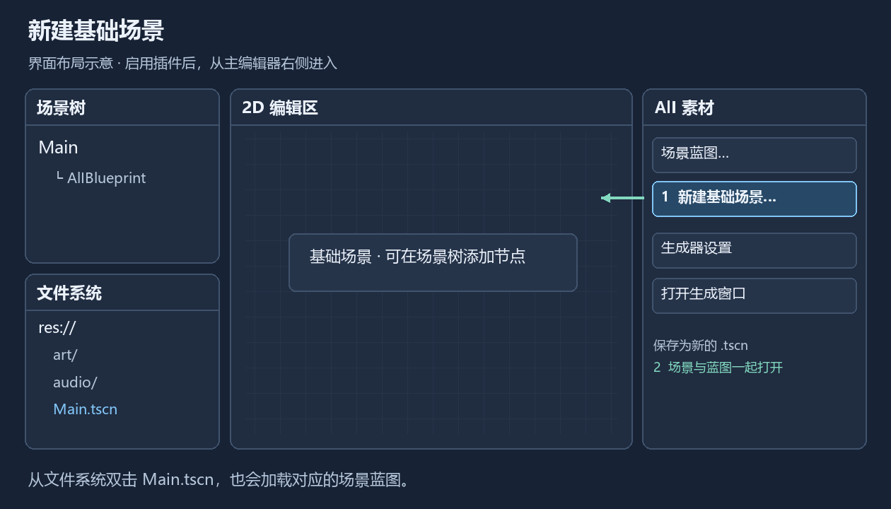
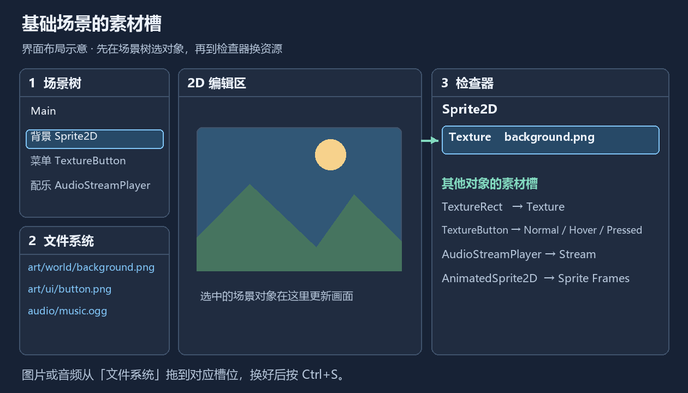
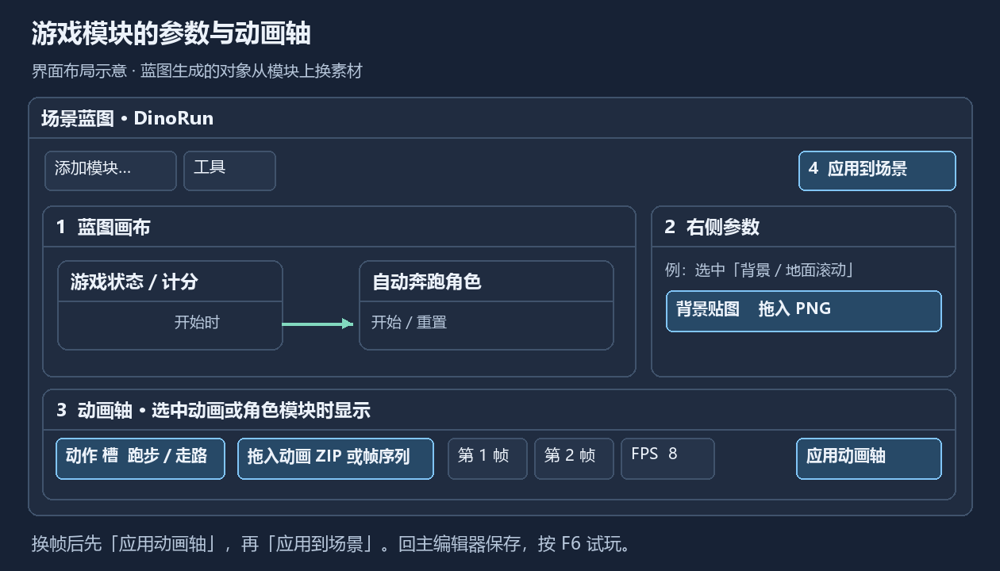

# Godot 基础场景与素材更换图解

## 1. 建立场景

1. 在 Godot 的「项目 → 项目设置 → 插件」启用「AlI游戏素材」。右侧出现「AlI 素材」。面板的「生成器设置」可查看或修改本机 AlI 路径。
2. 点「新建基础场景…」，例如保存成 `res://Main.tscn`。Godot 会打开该场景和它的空白蓝图。下次打开同一个基础场景时，已保存的蓝图自动加载。
3. 在左侧场景树添加对象，例如 `Sprite2D`、`AnimatedSprite2D`、`Button` 或 `Camera2D`。在蓝图画布点「添加模块」，用右侧参数选择目标节点。
4. 连好执行线和数据线，点「应用到场景」，回主编辑器按 Ctrl+S。按 F6 运行当前场景。可在 Godot 项目设置中选择 F5 使用的主场景。

已有的普通 Godot 场景也可打开「场景蓝图」编辑。切换到其他场景时，当前窗口会跟随场景。应用并保存前的蓝图改动在本次编辑器会话中保留。

## 2. 换基础场景里的素材

先把图片、音频等文件加入 Godot 项目。可以放进项目的 `art` 或 `audio`，等它们出现在左下「文件系统」。下列操作从场景树选节点开始。

| 要替换的内容 | 选中或新建节点 | 拖入位置 |
| --- | --- | --- |
| 背景、角色静态图、道具 | Sprite2D | 检查器的 Texture |
| 菜单背景、插画 | TextureRect | 检查器的 Texture。全屏背景可设全矩形、保持比例铺满 |
| 按钮外观 | TextureButton | Textures 下的 Normal、Hover、Pressed，各放一张图 |
| 音乐、环境声、点击音 | AudioStreamPlayer 或 AudioStreamPlayer2D | 检查器的 Stream。按需要设置音量或用蓝图事件触发 |
| 帧动画 | AnimatedSprite2D | 已有 SpriteFrames 可填入 Sprite Frames。外部帧和 AlI 的 ZIP 用下一节的动画轴 |

熟悉后可先从同一个节点替换原资源，位置和信号继续用原节点。若图片换过以后大小不同，在选中节点后检查缩放、对齐点，以及与贴图配合的碰撞形状。

## 3. 替换游戏模块绑定的素材

1. 在 Godot 打开游戏场景，从「AlI 素材」打开「场景蓝图」。选中控制画面或声音的模块。
2. 对节点自身的贴图，使用上一节的检查器。对蓝图运行时创建的图层、障碍、角色或声音，在模块右侧参数换资源。

| 游戏模块 | 可替换的资源及参数 |
| --- | --- |
| 背景／地面滚动 | 背景贴图、地面贴图、地面高度、滚动倍率 |
| 障碍生成／碰撞 | 障碍贴图、宽高、滚动速度和生成间隔 |
| 自动奔跑角色 | 选下方动作槽，逐个更换走路／奔跑、跳跃和死亡动画 |
| 通用动画 | 动画轴、目标节点、片段、播放速度、循环 |
| 播放声音 | 音频文件、总线、音量和循环 |
| 按钮或菜单／分数／设置UI | 普通、悬停、按下等贴图，以及按钮文字、面板或标题 |

3. 把 PNG、WAV、OGG 等从 Godot 文件系统拖到对应的资源槽，或点资源槽选择。确认缩略图或文件名更新后，点「应用到场景」并保存。每换一组素材，可以按 F6 检查实际画面和声音。

## 4. 导出一段动画并接入对象

1. AlI 生成完成后，在「选帧与导出」勾选要保留的帧。预览会随勾选自动更新，也可点击下方缩略图暂停并核对单帧。按需要启用透明背景，点「导出动画…」保存 ZIP。这个文件包含全部选中帧、顺序、FPS 和循环设置。
2. 回到 Godot，在场景树选中要播放动画的对象。添加「通用动画」模块并选中它。画布下方会出现动画轴。
3. 从资源管理器将 ZIP 拖到动画轴。也可拖入图片文件夹或批量选择 PNG、JPG、WebP 帧文件。支持带切片描述的 AlI 精灵图，以及当前项目的 `SpriteFrames`。普通文件按自然顺序排列，例如 `frame2.png` 在 `frame10.png` 前。
4. 在动画轴点击某帧看预览，可以调顺序、帧时长倍率、FPS、整体播放速度、循环和反向。点「应用动画轴」把片段绑定到模块。素材资源会自动存入当前项目。
5. 给动画连接一个触发事件。例如添加「游戏／场景事件」，事件选「初始化完成」，再把它的「发生」接到通用动画的「播放」。
6. 点「应用到场景」并保存。若目标是普通 2D 对象且缺少精灵节点，插件会在对象下添加 `AlIVisual`。若对象下有多个 AnimatedSprite2D，在参数区指定一个。

多个动作可分别用通用动画模块，再通过按键、状态机或其他事件连接播放。导出 ZIP 供帧动画编辑使用。外部 MP4 和 GIF 可先在 AlI 选帧并导出，或用已有工具拆成图片序列。

## 5. 创建自己的函数模块

1. 在「工具」选「新建空白函数…」。小画布只有入口和返回，从中间自行添加模块并连接执行线。根据需要添加「子图输入参数」和「子图返回参数」。
2. 选「保存局部函数…」或「保存全局函数…」，给函数命名。也可以将画布上已连接的一组模块保存为函数。
3. 返回场景画布，在「添加模块」搜索函数名，接入执行线。带输入值的函数可在参数区填写调用参数。选中调用模块后也可以点「编辑此函数…」。

| 作用域 | 可见与调用范围 |
| --- | --- |
| 局部函数 | 创建它的场景 |
| 全局函数 | 当前 Godot 项目的所有场景 |

全局函数中如需操作不同场景的对象，使用参数把目标传进去。全局函数可以调用其他全局函数。修改被引用函数之后，重新应用调用它的场景，运行时会使用更新后的函数。

## 6. 第一次试玩时检查

- F6 能运行当前场景。蓝图应用后，回到 Godot 主窗口保存。
- 图片换了但画面没变化时，先确认显示的是场景对象还是蓝图创建的对象，再查看对应的检查器或参数槽。
- 动画轴能预览时，再检查模块目标是否绑定，以及播放端口是否接上事件。
- 图片和音频应出现在当前项目的「文件系统」里。动画轴还可以直接接收项目外部的帧文件。
- 需要手动搭建一个带操作和菜单的练习，参考[小恐龙实操教程](DINO_AI_ASSETS_TUTORIAL.md)。
